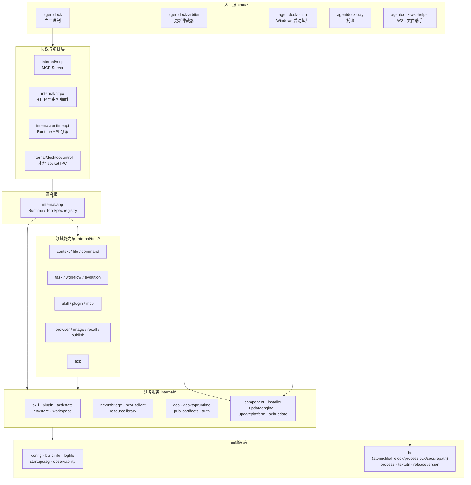

# 系统分层架构

AgentDock 是单进程 Go 服务：一个二进制同时扮演 MCP Server、HTTP 控制面、设备执行器与桌面控制端点。桌面端（macOS/Windows）只是**控制面板**，不承载业务执行逻辑。

## 分层视图



依赖方向严格单向：`cmd → 协议层 → app → tool → 领域服务 → 基础设施`。**反向依赖为零**——`internal/tool/*` 不 import `internal/app`（`app` 把 handler 以闭包形式注入），`internal/skill` 不认识 `internal/tool/skill`。

## 各层职责与边界

| 层 | 目录 | 职责 | 明确不做 |
|---|---|---|---|
| 入口层 | `cmd/*` | 参数解析、信号处理、子命令路由、平台分支 | 业务规则 |
| 协议与编排 | `internal/mcp`、`internal/httpx`、`internal/runtimeapi`、`internal/desktopcontrol` | 协议适配（MCP JSON-RPC / HTTP / 本地 IPC）、鉴权、请求体积限制 | 工具语义 |
| 组合根 | `internal/app` | 依赖装配、工具注册表、契约编译、生命周期 | 具体 IO 实现 |
| 领域能力 | `internal/tool/*` | 单工具的入参规范化、错误码、结果形状 | 跨工具编排 |
| 领域服务 | `internal/{skill,plugin,taskstate,...}` | 持久化、事务、协议客户端 | HTTP 传输 |
| 基础设施 | `internal/{config,fs,process,...}` | 配置、原子写、锁、进程控制、日志 | 业务概念 |

### 关键边界规则

1. **`internal/app` 是唯一组合根**。所有依赖在 `NewRuntime` 构造，运行期不 new 服务（例外：`resourcelibrary.Service` 用 `sync.Once` 懒加载）。
   - 见 `internal/app/runtime.go:67`。
2. **工具注册表单点**。`buildToolSpecs`（`internal/app/specs_registry.go:5`）按固定顺序拼装全部 `ToolSpec`；`indexToolSpecs` 对空名/空 Contract/空 Handler/重名 **panic**，把注册错误提前到进程启动。
3. **契约所有权在能力包**，不在 `app`。`ToolSpec.Contract` 是 `ToolContractProvider` 函数指针，`app` 不按名字二次查找 schema 归属（`internal/app/specs.go:14-26`）。
4. **协议层不知道工具名**。`mcp.callTool` 只校验 arguments 是 JSON object，随后交给 `Runtime.Call`；工具分派完全由 `toolSpecIndex` 完成。

## 进程内拓扑

一个 `agentdock` 进程内并发运行以下长生命周期组件：

| 组件 | 启动位置 | 生命周期 |
|---|---|---|
| HTTP server（或 stdio 传输） | `cmd/agentdock/server.go:28 runServer` | 主 ctx |
| MCP Apps 资源 | `internal/mcp/apps.go` | 随 Server |
| 动态 MCP 客户端 Manager | `internal/app/runtime.go:86 mcpclient.NewManager` | Runtime.Close |
| Nexus bridge 客户端 | `server.go`（已配对时 goroutine） | `serviceCtx` + `bridgeWG` |
| desktopcontrol socket 服务 | `server.go`（`AGENTDOCK_RUNTIME_ROOT` 非空） | 与 HTTP 同 `done` chan |
| ACP 管理器（每 profile 一个） | `internal/app/runtime.go`（`ACPEnabled`） | Runtime.Close |
| 浏览器会话 | `internal/tool/browser` 惰性创建 | Runtime.Close / 空闲回收 |

**关闭顺序是硬约束**：`cancelServices()` → `bridgeWG.Wait()` → `Runtime.Close()`。Nexus 客户端仍在处理 invoke 时关闭 Runtime 会 panic。

## 两种传输模式

| 模式 | 触发 | 实现 |
|---|---|---|
| stdio | `cfg.Stdio`（`AGENTDOCK_STDIO=true` 或 `--stdio`） | `cmd/agentdock/server.go:164 serveStdio` → `internal/mcp/server.go:108 ServeStdio` |
| Streamable HTTP | 默认 | `internal/httpx/server.go:21 Serve` → `/mcp` → `internal/mcp/server.go:104 HTTPHandler` |

stdio 模式下不启动 `httpx`，但 Runtime、工具、Nexus 都不受影响——MCP 传输与设备能力解耦。

## 桌面端分层（非 Go）

| 平台 | 语言 | 定位 | 与 Core 的交互 |
|---|---|---|---|
| macOS | Swift / AppKit（`desktop/macos/AgentDockApp/Sources/`，34 文件） | 托盘 + 原生控制面板 + 更新进度窗 | `desktopcontrol` Unix socket（`<runtimeRoot>/control.sock`） |
| Windows | C# / WinUI 3（`desktop/windows/winui/`） | 首页/连接/能力/设置/活动 5 页 | 本地 IPC + 命名管道 |

桌面端**不持有**任何设备凭据或任务状态；它只读取 Runtime API 与 `DispatchControlRequest` 暴露的只读视图。

## 目录速查

```text
cmd/                     5 个入口二进制
internal/                39 个包
internal/tool/           206 个 Go 文件，按工具分 14 个子包
internal/desktopruntime/ 75 个文件（tunnel/service/task session/adapter）
internal/app/            64 个文件（Runtime + specs + 各工具 handler 绑定）
core-skills/             4 个内置 Skill（随镜像分发）
desktop/{macos,windows}  桌面端源码
packaging/               安装器、签名、镜像资源
scripts/{install,test,governance}
docs/                    11 篇设计文档
```

## 相关文档

- 部署形态、端口、环境变量 → 详见 [部署与运行架构](./部署与运行架构.md)
- 依赖版本与中间件 → 详见 [技术栈与中间件](./技术栈与中间件.md)
- 工具清单与职责 → 详见 [核心功能模块](../02-功能结构和策略/核心功能模块.md)
- 单次工具调用的完整链路 → 详见 [MCP工具调用全链路](../03-核心数据业务流/MCP工具调用全链路.md)
