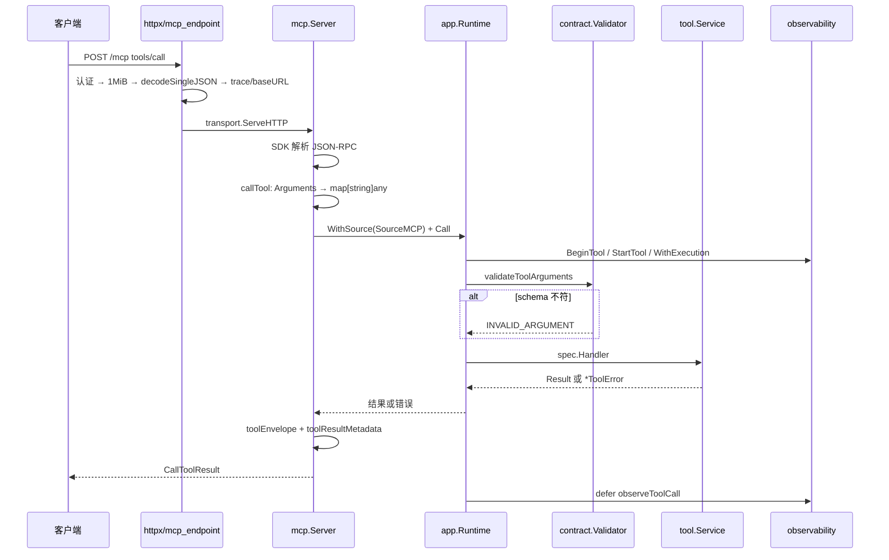

# MCP 工具调用全链路

一次 `tools/call` 从 HTTP 请求到 JSON-RPC 响应，经过 6 个可观测阶段。本文按阶段给出 `文件:行号`。

## 触发点

三类入口，全部收敛到 `Runtime.Call`：

| 入口 | 触发方式 | 认证 | 代码 |
|---|---|---|---|
| HTTP Streamable | `POST /mcp`，JSON-RPC `tools/call` | Bearer / OAuth | `internal/httpx/mcp_endpoint.go:45` |
| stdio | 进程 stdin 的 JSON-RPC | 无（进程权限即边界） | `internal/mcp/server.go:108 ServeStdio` |
| Nexus bridge | WebSocket `OperationToolCall` | Device Token | `internal/nexusbridge/client.go:279 invoke` |

## 数据流路径



逐节点：

| # | 节点 | 位置 | 关键动作 | 失败表现 |
|---|---|---|---|---|
| 1 | 认证 | `internal/httpx/mcp_endpoint.go:50-56` | `staticOK = cfg.AuthToken != "" && Bearer.Authorized(r)`；`oauthOK = authorizedOAuth(...)` | 401 + `WWW-Authenticate` 挑战头 |
| 2 | 请求体闸门 | `mcp_endpoint.go:65` → `:66` | `http.MaxBytesReader(w, r.Body, 1<<20)` | 413 `request body exceeds 1048576 bytes` |
| 3 | 单值 JSON | `mcp_endpoint.go:80` → `httpx/json.go:11` | `decodeSingleJSON` 拒绝尾随第二个值 | HTTP 200 + JSON-RPC `-32700 Parse error` |
| 4 | 上下文注入 | `mcp_endpoint.go:60-62` | OTel `traceparent` 提取 + `requestmeta.WithBaseURL` | 无（baseURL 为空则不入 ctx） |
| 5 | SDK 分发 | `internal/mcp/server.go:45-56` | stateless + JSONResponse + `PropagateRequestCancellation` | 未知 method → `-32601` `[INFERENCE]` |
| 6 | 参数反序列化 | `server.go:147-152` | 只有非空且非 `null` 才 `json.Unmarshal` 成 map | `-32602 tool arguments must be a JSON object`；日志只记工具名 |
| 7 | Source 标注 | `server.go:155` | `observability.WithSource(ctx, SourceMCP)` | — |
| 8 | Runtime 入口 | `internal/app/runtime.go:281` | `BeginTool` → `StartTool` span → `WithExecution` → `defer observeToolCall` | — |
| 9 | **唯一 schema 校验** | `runtime.go:309` | `toolValidators[name].Validate(args)`；未注册 → `UNKNOWN_TOOL` | `INVALID_ARGUMENT` + `details.reason` |
| 10 | spec 查找 | `runtime.go:300` | `toolSpecByName(name)` O(1) 索引 | `UNKNOWN_TOOL` / `tool has no handler` |
| 11 | handler 执行 | `runtime.go:305` | `spec.Handler(ctx, r, args)` | 各 Service 的 `*ToolError` |
| 12 | 强类型解码 | `internal/app/input_decode.go:13` | `typedToolHandler[T]` 把 map 解成 struct，`ensureJSONEOF` 拒尾随 | `INVALID_ARGUMENT` |
| 13 | 结果封装 | `server.go:274 toolEnvelope` | 成功 → `{isError:false, structuredContent, content}`；错误 → 展开 `code/category/retryable/details` | 编码失败 → Go error |
| 14 | UI 元数据 | `server.go:167-184` | descriptor 级 `_meta.ui` + action 级 `toolResultMetadata`；`view_image` 追加 `ImageResultText` | 静默跳过 |
| 15 | 观测落账 | `internal/observability/recorder.go:95 EndTool` | 白名单字段：tool/source/duration/ok/error_code/error_category/trace_id/span_id/stages | 不影响响应 |

## 关键节点详解

### 为什么校验只在 Runtime 做一次

`internal/mcp/server.go:139-143` 的注释是设计声明：SDK 只做协议、会话、传输，参数校验归 Runtime。好处是 stdio、HTTP、Nexus 三个入口**共用同一份校验逻辑**，不会出现"HTTP 上被拦、stdio 上放行"的差异。

validator 在启动期编译（`internal/app/specs.go:128 compileAvailableToolContracts`），以 schema 的 JSON 序列化结果为缓存键（`specs_validation.go:16`）。所以 `task_manage` 在"有 Nexus"和"无 Nexus"两种配置下各有自己的 validator，互不干扰。

### 错误信封的形状

```
成功：{isError:false, structuredContent:<业务结果>, content:[{type:"text", text:<pretty JSON>}]}
失败：{isError:true,  structuredContent:{tool, error, code, category, retryable, details},
       content:[{type:"text", text:<pretty>}]}
```

三类特例：

| 工具 | 特例 | 位置 |
|---|---|---|
| `view_image` | 剥离内部字段 `_mcp_image_base64`/`_mcp_image_mime_type`，返回 `{type:"image", data, mimeType}` | `server.go:293-300` |
| `mcp_tool_call` | 透传远端 `content` 与 `isError`，不重新包装 | `server.go:307-320` |
| `PERMISSION_REQUIRED` | 额外加 `permission_request{tool_name, permission, status:"required"}` | `server.go:283-289` |

**所有业务错误都是 HTTP 200**。协议错误（401/413/-32602）才是非 200 或 JSON-RPC error。这个边界必须守住，否则 MCP 客户端会把业务失败当成传输失败重试。

### 观测的作用

`observeToolCall` 在 `defer` 里执行，无论成功失败都记。stage 机制用于诊断动态 MCP：

| 场景 | stages |
|---|---|
| 动态 MCP 冷调用 | `MCPRefresh` → `MCPRemoteCall` |
| 动态 MCP 热调用 | `MCPRemoteCall` |

`MaxStagesPerExecution = 16`，超出的 stage 被丢弃（不是截断报错）。

## 异常路径

| 场景 | 位置 | 表现 |
|---|---|---|
| 未认证 | `mcp_endpoint.go:52-56` | 401；OAuth 模式挑战头含 `resource_metadata` |
| 带无效 token | `internal/httpx/oauth.go:273-289` | 挑战头加 `error="invalid_token"` |
| 请求体 > 1 MiB | `mcp_endpoint.go:67-72` | 413 |
| 多个 JSON 值 | `mcp_endpoint.go:80-88` | HTTP 200 + `-32700` |
| `Arguments` 非对象 | `server.go:149-152` | `-32602`；日志不记正文 |
| 工具不存在 | `runtime.go:311-313` | `UNKNOWN_TOOL` / `validation` |
| schema 不符 | `runtime.go:317-323` | `INVALID_ARGUMENT` + 实例路径（`$.path is required`） |
| handler panic | `internal/app/runtime_observability.go:77` | 记 `PANIC`/`runtime` 后**重新抛出**；HTTP 路径由 net/http 关连接，stdio 路径进程退出 |
| 客户端断开 | `server.go:54` | ctx 取消 → 工具见 `CANCELED`；`exec_command` 返回带 `session_reason:"request_cancelled"` 的快照而非硬失败 |
| Runtime 正在关闭 | `runtime.go:252-258` | `RUNTIME_CLOSING` / `runtime` |

## 关联组件

| 组件 | 参与方式 |
|---|---|
| `internal/app/runtime.go` | 唯一执行入口，持有 `toolValidators` 与 `toolSpecIndex` |
| `internal/tool/contract` | schema 构造（`InputObject`/`OutputObject`）与 validator |
| `internal/observability` | 环形缓冲 500 条执行记录 + OTel span |
| `internal/mcp/apps.go` | UI 资源与 `ui` 元数据 |
| `internal/auth` | Bearer 与 OAuth 双通道 |

## 相关业务流

→ 详见 [Plugin审核安装激活全链路](./Plugin审核安装激活全链路.md)（`plugin_manage` 的重活）
→ 详见 [Nexus配对与隧道全链路](./Nexus配对与隧道全链路.md)（`recall_*`/`evolve` 依赖配对）
