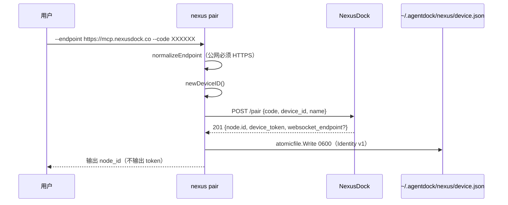
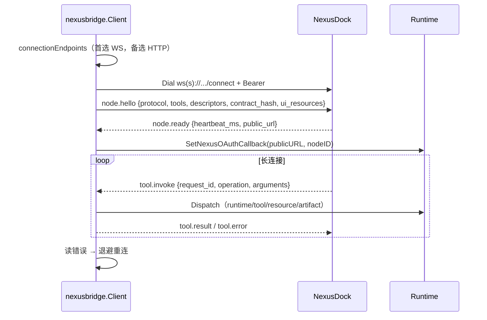

# Nexus 配对与隧道全链路

两条独立的出站链路，常被混为一谈：

- **Nexus Bridge**：WebSocket 长连接到 NexusDock 控制面，让远端（Web/手机/其它 AI 宿主）反向调用本机装置。走 `internal/nexusbridge`。
- **Cloudflare Tunnel**：cloudflared 把本机 HTTP 暴露成公网 URL，让任意 MCP 客户端直连。走 `internal/component` + `internal/desktopruntime`。

二者都能"从外网访问本机"，但**不互相依赖**。可以只配对 Nexus，也可以只开 Tunnel。

## 触发点

| 能力 | 触发 | 位置 |
|---|---|---|
| 配对 | `agentdock nexus pair --endpoint --code` | `cmd/agentdock/command_nexus.go:33` |
| 状态查询 | `agentdock nexus status` | `command_nexus.go:29` → `nexusbridge.ReadStatus` |
| Bridge 启动 | 服务启动时检测到已配对 | `cmd/agentdock/server.go`（goroutine `NewClient(...).Run(serviceCtx)`） |
| Tunnel 启停 | `agentdock tunnel start/stop/restart/regenerate` | `internal/desktopruntime/tunnel_command.go:39-45` |
| Tunnel 配置 | `agentdock tunnel configure --mode quick|named` | `tunnel_command.go:80` |
| 组件安装 | `agentdock component install cloudflared` | `cmd/agentdock/command_component.go:17` |

## 一、配对

| # | 节点 | 位置 | 关键动作 | 失败表现 |
|---|---|---|---|---|
| 1 | endpoint 归一 | `identity.go:174 normalizeEndpoint` | 去尾斜杠；`http` 仅允许 localhost/回环 IP | `公网 NexusDock endpoint 必须使用 HTTPS` |
| 2 | 配对码 | `identity.go:55-58` | 非空 | `配对码不能为空` |
| 3 | 设备名 | `identity.go:58-64` | 空则取 hostname，再空则 `"AgentDock"` | — |
| 4 | device_id | `identity.go:196 newDeviceID` | 本地生成，非服务端下发 | — |
| 5 | 请求 | `identity.go:71-84` | `POST <endpoint>/pair`，15s 超时 | `连接 NexusDock 配对接口` |
| 6 | 响应读取 | `identity.go:88` | `io.LimitReader(body, 1<<20)` | `读取 NexusDock 配对响应` |
| 7 | 状态码 | `identity.go:92` | 必须 201 | `配对失败（HTTP %d）: <body>` |
| 8 | 身份校验 | `identity.go:100-102` | `node.id` 与 `device_token` 均非空 | `配对响应缺少节点身份` |
| 9 | WS endpoint | `identity.go:103-110` | 可选；给了则归一化 | `返回的 WebSocket endpoint 无效` |
| 10 | 落盘 | `identity.go:158 Save` | `atomicfile.Write(0600)` 到 `nexus/device.json` | `保存 NexusDock 设备身份` |

**Linux 特别提示**：`command_nexus.go:56-61` 在未指定 `--agentdock-home` 且 `AGENTDOCK_HOME` 为空时打印警告 —— systemd 的 Core 通常不以当前终端账号运行，配对码一次性，写错 HOME 后必须重新配对。

### 凭据只来自文件

服务启动时 `cmd/agentdock/server.go:33-35` 会 `os.Unsetenv("AGENTDOCK_NEXUS_ENDPOINT")` 与 `AGENTDOCK_NEXUS_TOKEN`。这是**故意的**：旧版本用环境变量传凭据，会导致容器/服务单元里残留明文 token 且与 `device.json` 不一致。现在唯一来源是 `~/.agentdock/nexus/device.json`，启动时 `nexusbridge.Load` 覆盖 `cfg.NexusEndpoint`/`cfg.NexusDeviceToken`。

`Status`（`identity.go:36`）暴露 `paired`/`endpoint`/`node_id`/`device_id`/`device_token_stored`，**不含 token 本身**。

## 二、WebSocket 长连接

| # | 节点 | 位置 | 关键动作 |
|---|---|---|---|
| 1 | 端点列表 | `client.go:102 connectionEndpoints` | 首选 `WebSocketEndpoint`，回退 `Endpoint`；老 identity 无 WS 字段时只有官方 SaaS 补默认值 |
| 2 | 退避循环 | `client.go:68 Run` | 1s 起，×2 至 30s，+0~500ms 抖动；稳定 30s 后重置 |
| 3 | 拨号 | `client.go:164 connect` | `https→wss`/`http→ws`；path 追加 `protocol.ConnectPath`；`Authorization: Bearer <device_token>` |
| 4 | fallback 判定 | `client.go:123-128`、`:130` | HTTP 408/425/429/5xx 或 socket 层错误 → 试备选端点 |
| 5 | context 联动 | `client.go:187-189` | `context.AfterFunc` 关 socket，让阻塞 `ReadJSON` 立即返回 |
| 6 | 消息上限 | `client.go:192` | `SetReadLimit(8 MiB)` |
| 7 | 握手 | `client.go:199-204` | `node.hello` 带 tools + descriptors + `tool_contract_hash` + UI 资源能力 |
| 8 | 就绪 | `client.go:205-211` | 必须 `node.ready` 且协议版本一致，否则 `不兼容的节点协议` |
| 9 | OAuth 回调 | `client.go:212-225` | 失败**只告警**，不阻断 bridge |
| 10 | 心跳 | `client.go:389` | 服务端给 `heartbeat_ms`，缺省 30s |
| 11 | 收包分派 | `client.go:238-256` | `tool.invoke` 每请求一 goroutine；`tool.cancel` 取消；`node.heartbeat` 忽略 |
| 12 | 退出排空 | `client.go:151 drainInvocations` | 最多等 5s 让在途请求完成 |

### 单次请求的执行边界

`invoke`（`client.go:279`）有 `recover()`：panic 收敛为 `NODE_OPERATION_FAILED` / `category:"internal"`，只结束当前请求。注释原文：「Nexus Bridge 是远程 RPC 边界。单次工具 panic 只结束当前请求，避免把整个 AgentDock 守护进程和其他本地会话一并带崩。」

`bridgeError`（`client.go:421`）**不回传原始 message 到非 ToolError 场景之外的细节** —— `[INFERENCE]` 从实现看：`ToolError` 透传 `Code/Category/Details`，其它错误统一 `NODE_OPERATION_FAILED` + `err.Error()`。

五个 operation：

| Operation | 参数 | 落到 |
|---|---|---|
| `runtime_request` | `runtimeapi.Request` | `runtimeapi.Dispatch`；body > 64 KiB → `INVALID_ARGUMENT` |
| `context_local` | 无 | `node.AgentDockLocalContext` |
| `tool_call` | `{tool, arguments}` | `node.Invoke`，source 标 `SourceNexus` |
| `resource_read` | `{uri}` | `node.ReadAppResource`（MCP Apps） |
| `artifact_read` | `{artifact_id, offset, max_bytes}` | `readArtifactChunk`（`artifacts.go:10`） |

### 关闭顺序

`server.go` 里 `defer` 的顺序不能错：先 `cancelServices()`，再 `bridgeWG.Wait()`，**最后** `Runtime.Close()`。顺序反了的话 bridge 还在处理请求时 Runtime 已经开始拆工具，会拿到 `RUNTIME_CLOSING`。

## 三、Cloudflare Tunnel

Tunnel 是**可选组件**，cloudflared 二进制由 `internal/component` 独立管理（不随安装包分发）。

### 三种模式

| 模式 | 含义 | 依赖 | 就绪判定 |
|---|---|---|---|
| `none` | 关闭 | 无 | 恒 `ready:true` |
| `quick` | 随机 `*.trycloudflare.com` URL | cloudflared | 组件可用 + 服务运行 + `quick-tunnel-url.txt` 与 core 一致 |
| `named` | 用户自己的域名 | cloudflared + token | 组件可用 + 服务运行 |

配置写入 `AGENTDOCK_TUNNEL_MODE` 与相关 env（`envstore.ParseFile` 读，`tunnel_unix.go:22`）。

### 命令路径

`RunTunnelCommand`（`tunnel_command.go:39`）：

| 子命令 | 实现 | 是否走 IPC |
|---|---|---|
| `status` | 先 `desktopcontrol.Call("tunnel.status")`，失败回退 `platformTunnelStatus` | 是（只读） |
| `launch` | `platformLaunchTunnel` | 否 |
| `start`/`stop`/`restart`/`regenerate` | `platformTunnelAction` | **否** |

注释（`tunnel_command.go:75-76`）说明原因：「写操作可能重启当前核心，必须由独立控制进程直接调用系统适配器；IPC 仅用于不会改变服务生命周期的状态读取。」

`regenerate` 只对 `quick` 模式有效：先 `invalidateQuickTunnelPublicState` 让旧 URL 失效，再降级成 `restart`。

### cloudflared 组件子系统

| 环节 | 位置 | 说明 |
|---|---|---|
| catalog baseline | `internal/component/catalog-v1.json` | schema v2 / revision 3；5 平台 × url + mirror_url + pinned sha256 |
| 解析顺序 | `cloudflared.go:345-414` | `--catalog-url` → 远程 → 本地缓存 → 内嵌 |
| 下载 | `cloudflared.go:331-342` | R2 mirror 优先，回退官方；两侧同一 pinned 摘要 |
| 落盘 | `cloudflared.go:565-604 commitStaged` | `components/cloudflared/versions/<v>/cloudflared[.exe]` |
| 激活 | `cloudflared.go:610-631 writeActive` | `active.json` 指针 |
| 版本选择 | `cloudflared.go:862-903` | 兼容区间 `0.9.1 – <2.0.0`；`revoked` 永不选中 |
| 信任 | `trust_windows.go:12` / `trust_darwin.go:15` / `trust_linux.go:10` | Authenticode / `codesign --verify --strict` / 拒绝 legacy 导入 |

**为什么 `revoked` 永不选中**：catalog 可以在发现供应链问题时把某版本标为 revoked。即使本地已下载且摘要正确，也不会被激活 —— 这是"撤回"权重的体现，代价是可能让用户暂时无可用版本。

## 异常路径

| 场景 | 表现 |
|---|---|
| 配对码为空 | `配对码不能为空` |
| endpoint 是公网 http | `公网 NexusDock endpoint 必须使用 HTTPS` |
| 配对返回非 201 | `配对失败（HTTP %d）: <body>` |
| 配对响应缺身份 | `配对响应缺少节点身份` |
| `device.json` 损坏 | `Load` 返回解析错误 → 启动时只记日志，不阻断（视作未配对） |
| WS 首选端点不可用 | 满足 fallback 条件时试备选；否则退避重连 |
| 协议版本不匹配 | `NexusDock 返回了不兼容的节点协议`，退避重连 |
| 单次 tool panic | `NODE_OPERATION_FAILED`，连接保留 |
| 读超时/连接断 | `ReadJSON` 报错 → 退避重连；在途请求最多等 5s |
| bridge 关闭超时 | `in-flight invocations drain timeout` 告警后继续 |
| Tunnel mode=none 但调 start | `Tunnel 模式为 none` |
| Tunnel  quick 调 regenerate | `只有 Quick Tunnel 可以重新生成地址` |
| cloudflared 组件缺失 | `DependencyState = not_installed`；tunnel 命令返回配置错误 |

## 关联组件

| 组件 | 参与方式 |
|---|---|
| `internal/nexusbridge` | Identity、Client、ConnectionState、trace 透传 |
| `internal/nexusclient` | 配对 HTTP 客户端（`CheckRedirect → ErrUseLastResponse`，阻止重定向带 token） |
| `internal/component` | cloudflared 版本目录、catalog、信任校验 |
| `internal/desktopruntime` | Tunnel 平台适配（systemd / launchd / Windows 服务或计划任务） |
| `internal/desktopcontrol` | 只读状态 IPC（`tunnel.status`） |
| `internal/app/mcp_oauth.go` | `SetNexusOAuthCallback` / `RuntimeMCPOAuthCallback` |

## 相关业务流

→ 详见 [MCP工具调用全链路](./MCP工具调用全链路.md)（Nexus 是第三个入口）
→ 详见 [自更新事务全链路](./自更新事务全链路.md)（cloudflared 组件更新与主更新正交）
→ 详见 [Plugin审核安装激活全链路](./Plugin审核安装激活全链路.md)（Plugin 的 MCP 组件与 Nexus 无关，别混淆）
