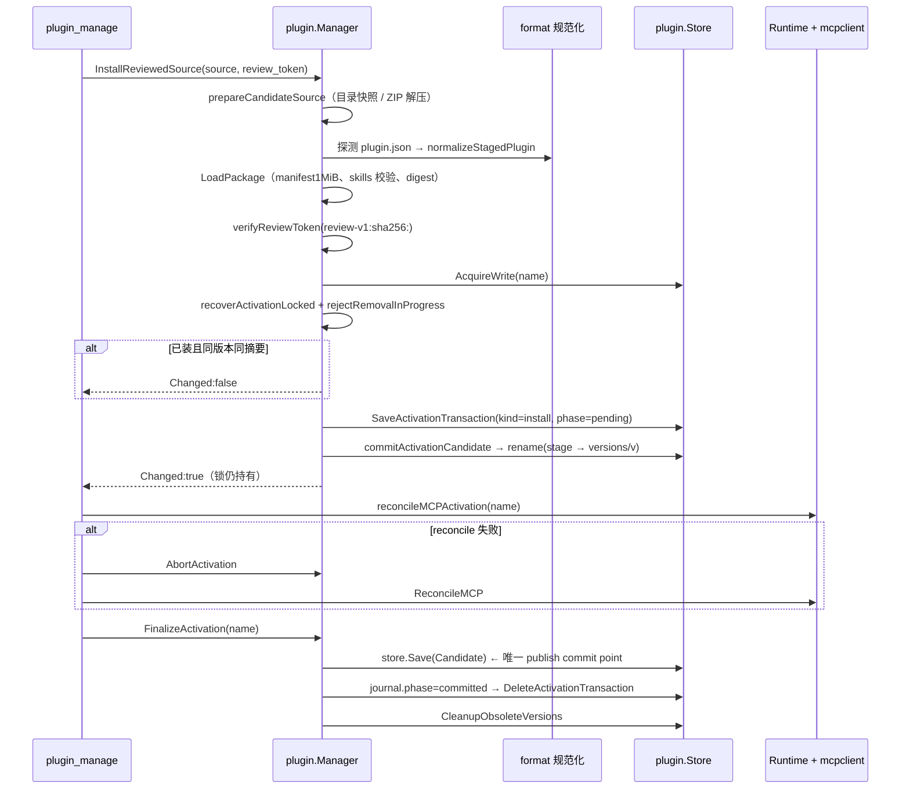

# Plugin 审核安装激活全链路

Plugin 是「多个 Skill + 多个 MCP 组件 + 任意资源」的包。与 Skill 的单目录替换不同，Plugin 有版本目录、三级租约、activation journal、MCP runtime reconcile —— 因为运行中的进程持有包内文件句柄。

## 触发点

| 触发方式 | 入口 | 说明 |
|---|---|---|
| MCP 工具 | `plugin_manage` action `install`/`update` | `internal/tool/plugin/service.go:134-137` |
| 资源库 | `install_commit` → `InstallReviewedArchive` | `internal/tool/plugin/local_archive.go:17-22` |
| CLI | `agentdock plugin install <zip>` `[INFERENCE]` | 复用同一 `Service` |

7 个 action：`inspect`/`validate`/`install`/`update`/`enable`/`disable`/`remove`。参数 `review_token` 在 `install`/`update` 必填，`data_policy` 仅 `remove`（`keep`|`purge`）。

## 数据流路径



逐节点：

| # | 节点 | 位置 | 关键动作 | 失败表现 |
|---|---|---|---|---|
| 1 | 取源 | `internal/plugin/source.go:42` 起 | 目录快照或 ZIP 解压；ZIP 64 MiB / 解压 256 MiB / 10000 文件 | `PLUGIN_SOURCE_INVALID` |
| 2 | 格式探测 | `internal/plugin/format.go:119` | 根 `plugin.json` 优先；OpenAI+Claude 并存 → 歧义 | `PLUGIN_FORMAT_AMBIGUOUS` |
| 3 | 规范化 | `format.go:30` | 外部格式三段快照转 canonical Portable | `PLUGIN_FORMAT_CONVERSION_FAILED` + 阶段后缀 |
| 4 | 包加载 | `internal/plugin/package.go:37` | manifest ≤1 MiB、`skills/<n>/SKILL.md` 名一致、inert 目录告警 | `PLUGIN_PACKAGE_INVALID` / `PLUGIN_SKILL_INVALID` / `PLUGIN_MANIFEST_INVALID` |
| 5 | 摘要 | `package.go:111` | `DigestPackageContent(root)`；组件级摘要见 `:80` | 同上 |
| 6 | **审核令牌** | `internal/plugin/review.go:57` | 比对 `review-v1:sha256:`（绑定 digest+format+warnings+executables） | `PLUGIN_REVIEW_REQUIRED` / `PLUGIN_REVIEW_CHANGED` |
| 7 | 并发闸门 | `manager.go:181` | 有 pending activation → 拒绝 | `PLUGIN_ACTIVATION_IN_PROGRESS` |
| 8 | **写租约** | `manager.go:183` → `store.go:554` | `AcquireWrite(name)`，**一直持有到 finalize** | 错误原样上抛 |
| 9 | 崩溃恢复 | `manager.go:193` | `recoverActivationLocked` | 见下文 |
| 10 | 删除中检查 | `manager.go:196-198` | tombstone 存在 → 拒绝 | `PLUGIN_REMOVAL_IN_PROGRESS` |
| 11 | 幂等短路 | `manager.go:202-205` | 同版本同摘要 → `Changed:false` | 不同摘要 → `PLUGIN_ALREADY_INSTALLED` |
| 12 | **journal 先落** | `manager.go:228-230` | `SaveActivationTransaction(phase="pending")`；注释明示"首次安装也必须先落" | `PLUGIN_INSTALL_FAILED` / `install.journal` |
| 13 | 候选落盘 | `manager.go:231` → `commitActivationCandidate:735` / `commitCandidate:662` | `rename(stage, plugins/<name>/<version>)`；`local` 版本走 `.update-backup`/`.update-candidate-<owner>` | 回滚 rename；`PLUGIN_UPDATE_PENDING` |
| 14 | 挂起登记 | `manager.go:237-239` | `m.pending[name] = {transaction, commit, release}`；**保留锁** | — |
| 15 | MCP 激活 | `local_archive.go:62` | `reconcileMCPActivation(name)` 只启本 Plugin 的组件 | `PLUGIN_RUNTIME_ACTIVATION_FAILED` |
| 16 | **publish commit** | `manager.go:912` | `store.Save(transaction.Candidate)` | `PLUGIN_UPDATE_FINALIZE_FAILED` |
| 17 | journal 收口 | `manager.go:916-923` | `phase="committed"` → 删除；失败只 `slog.Warn` | 下次 recovery 从 formal state 向前收 |
| 18 | 版本清理 | `manager.go:926` | `CleanupObsoleteVersions` 保留 current + journal 的 Previous/Candidate | 静默 |

## 关键节点详解

### 为什么 lock 要跨两个阶段持有

`installPreparedCandidate` 在把候选包 rename 到位后**不释放**写锁（`keepLock = true`），把 release 存进 `pending`，直到 `FinalizeActivation` 才由 `finishPendingActivation` 释放。原因：如果中间释放，另一个进程可能在这个窗口启动一个 update，看到"已安装"的旧 state，然后把 candidate 目录当成孤儿版本清理掉。

这个设计有个代价：**reconcile 阶段如果卡住，锁会一直持有**。恢复逻辑只等 150 ms 拿锁，拿不到就跳过（`manager.go:1011-1027`），最长要等 25h stale reader 清理。

### activation journal 的状态机

`ActivationTransaction`（`internal/plugin/types.go:86-96`）关键字段：`Kind ∈ {install, update}`、`Phase ∈ {pending, committed}`、`OwnerID`、`Candidate State`、`Previous *State`、`LocalReplacement bool`。

| journal 状态 | formal state | 恢复动作 |
|---|---|---|
| `pending` | 不存在或 == `Previous` | 回滚：删 candidate state 与候选包 |
| `pending` | == `Candidate` | 前向：补跑 finalize（因为 publish 已完成） |
| `committed` | == `Candidate` | 前向收口：删 journal |
| 未知 phase | — | 报错，不做破坏性恢复 |

判定"已 publish"的方式是比对 formal state 与候选 state 的 `PackageDigest`（`manager.go:1065-1083`）。

### 三个租约的分工

| 租约 | 方法 | 保护什么 | 典型持有者 |
|---|---|---|---|
| binding | `store.go:457 AcquireBinding` | 仅 state → version 的绑定窗口，极短 | `Resolve` |
| version-read | `store.go:615 AcquireVersionRead` | 防止该版本目录被 GC | 运行中的 MCP 进程、Skill 读取 |
| writer | `store.go:554 AcquireWrite` | 全生命周期互斥 | install/update/enable/disable/remove |

`AcquireBinding` 的注释明确：**长时间操作必须用 `AcquireVersionRead`**，不能拿 binding 当长租约。

stale reader 清理阈值 25 小时（`store.go:29`），与 Skill 一致。

### state 里没有 MCP 明文

`stateComponentIndex`（`manager.go:590-603`）剥离了 `URL`/`Command`/`Args`/`CWD`/`Environment`/`Headers`/`HeaderEnv`/`EnvBindings`，只留名称、传输方式、storage key。

后果：每次 reconcile 都必须回读包内 `mcp.json`（`internal/tool/plugin/service.go:365-430`）。如果包目录不可读，插件在 state 中仍显示"已安装"，但 MCP 起不来 —— 表现为 `PLUGIN_PACKAGE_UNAVAILABLE` 或静默无组件。

好处：`state.json` 可以安全备份/传输，不含 token 与本地绝对路径。

### 版本目录与会话快照

```
plugins/<name>/<version>/          ← 不可变包
plugins/<name>/<version>.update-backup        （local 版本升级期）
plugins/<name>/.update-candidate-<ownerID>    （local 版本候选）
data/plugins/<name>/               ← 版本无关数据，升级保留
run/plugins/<name>/<version>/      ← stdio MCP 的可写 runtime 快照
state/plugins/<name>.json          ← formal state（≤2 MiB）
state/plugins/transactions/<name>.json
state/plugins/removals/<name>.json ← purge tombstone
locks/plugins/<sha256(name)>/      ← 三级租约
tmp/plugins/
```

`run/` 快照的意义：stdio MCP 进程常往自身目录写缓存，包目录必须保持不可变才能靠 digest 校验完整性。

### 为什么 purge 不可回滚

`remove` 的两种策略：

| 策略 | 语义 | 可逆 |
|---|---|---|
| `keep` | 删 state 与包，保留 `data/plugins/<name>` 与环境变量 | 可重装 |
| `purge` | 先写 `removalRecord{phase:"purging"}` tombstone，再删 state，再删数据 | **不可逆** |

tombstone 是 commit point（`manager.go:527-542`）。一旦落盘，后续 `Inspect`/`List`/`Acquire` 都视为不存在，清理失败只能前向重试 —— 这样保证"用户点了彻底删除"的意图不会因为一次 IO 错误而反转。

## 异常路径

| 场景 | 错误码 | 位置 | 回滚动作 |
|---|---|---|---|
| 来源非法（URL/symlink/超大） | `PLUGIN_SOURCE_INVALID` | `source.go:42-66` | 无 |
| 双 vendor 清单 | `PLUGIN_FORMAT_AMBIGUOUS` | `format.go:130-136` | 无 |
| 无任何清单 | `PLUGIN_FORMAT_NOT_FOUND` | `format.go:142-148` | 无 |
| `review_token` 空/不符 | `PLUGIN_REVIEW_REQUIRED` / `_CHANGED` | `review.go:57-65` | 无 |
| 已装异摘要 | `PLUGIN_ALREADY_INSTALLED` | `manager.go:200-206` | 无 |
| 非 local 同版本异摘要 | `PLUGIN_VERSION_DIGEST_CONFLICT` | `manager.go:690-692` | 无（永久冲突） |
| 有 pending activation | `PLUGIN_ACTIVATION_IN_PROGRESS` | `manager.go:181` | 无 |
| MCP 激活失败 | `PLUGIN_RUNTIME_ACTIVATION_FAILED` | `local_archive.go:62-72` | `AbortActivation` + `ReconcileMCP` |
| finalize 失败 | `PLUGIN_INSTALL_FINALIZE_FAILED` / `PLUGIN_UPDATE_FINALIZE_FAILED` | `local_archive.go:73-84`、`:143-154` | 停新 runtime → Abort → Reconcile |
| update 前停旧 runtime 失败 | `PLUGIN_RUNTIME_DEACTIVATION_FAILED` | `local_archive.go:98-106` | 不动包 |
| enable/disable 后 Save 失败 | `PLUGIN_STATE_CHANGE_FAILED` | `manager.go:409-414` | 用旧 state 反向 reconcile |
| CAS 冲突 | `PLUGIN_UPDATE_CAS_FAILED` | `manager.go:899` | 停 candidate |
| owner 变更 | `PLUGIN_UPDATE_NOT_OWNER` | `manager.go:889-897` | 停 candidate |
| 包被篡改 | `PLUGIN_PACKAGE_DRIFT` | `service.go:148-153`、`:370-377` | **无自动修复** |
| 包不可读 | `PLUGIN_PACKAGE_UNAVAILABLE` | `manager.go:1243-1262` | 无 |
| purge 失败 | `PLUGIN_PURGE_FAILED` | `manager.go:527-558` | 只能前向重试 |

工具层的错误归类（`service.go:542-554`）：错误码含 `INVALID`/`NOT_FOUND`/`REQUIRED`/`CONFLICT`/`UNSUPPORTED`/`CONFIRMATION` → `validation`；其余 → `runtime`；非 Plugin 错误 → `PLUGIN_MANAGE_FAILED`。

## 关联组件

| 组件 | 参与方式 |
|---|---|
| `internal/plugin/store.go` | 六类目录布局、state 2 MiB 上限、三级租约、`pluginLockKey` = sha256(name) |
| `internal/plugin/format.go` | Portable/OpenAI/Claude 三格式归一 |
| `internal/plugin/identity.go` | `ValidateName`/`ValidateVersion`；`RuntimeMCPName` = `plugin.<name>.<component>`（超长回退 hash 后缀） |
| `internal/mcp/client` | 每个启用的 MCP 组件一个 client；`Manager.ReconcileMCP` 做全量对齐 |
| `internal/tool/plugin/service.go` | `ownedMCPConfigs` / `mcpConfigsForInstalled` 回读包内 `mcp.json` |
| `internal/envstore` | `ScopePluginSkill` 注入 `PLUGIN_DATA_DIR` |

## 相关业务流

→ 详见 [MCP工具调用全链路](./MCP工具调用全链路.md)（`plugin_manage` 的入口）
→ 详见 [Skill安装与替换全链路](./Skill安装与替换全链路.md)（Plugin 内 Skill 的数据目录分野）
→ 详见 [任务状态与演进绑定全链路](./任务状态与演进绑定全链路.md)（`task_manage` 与 Plugin 无关，但共享 `atomicfile` + `filelock`）
