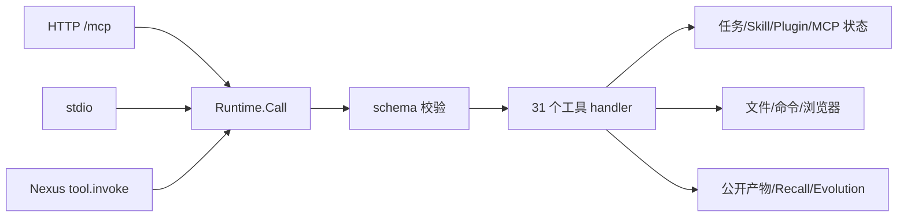

# 03-核心数据业务流 索引

六条端到端链路。每条都按「触发点 → 数据流路径 → 关键节点详解 → 异常路径 → 关联组件」组织，节点表带 `文件:行号`。

## 文档清单

| 文档 | 覆盖链路 | 关键事务保证 |
|---|---|---|
| [MCP工具调用全链路](./MCP工具调用全链路.md) | HTTP / stdio / Nexus 三入口 → `Runtime.Call` → schema 校验 → handler → 错误信封 | 业务错误一律 HTTP 200；输入 schema 单点校验 |
| [Skill安装与替换全链路](./Skill安装与替换全链路.md) | 三种来源 → 摘要 → 写锁 → swap journal → 两次 rename | 同 digest 幂等 no-op；journal 两阶段（`prepared` → `candidate_published`） |
| [Plugin审核安装激活全链路](./Plugin审核安装激活全链路.md) | 暂存 → 格式归一 → 审核令牌 → activation journal → MCP reconcile → finalize | 唯一 publish commit point = `FinalizeActivation` 内 `store.Save` |
| [Nexus配对与隧道全链路](./Nexus配对与隧道全链路.md) | 配对 → `device.json` → WebSocket 长连接；cloudflared 组件 + Tunnel 三模式 | 凭据只来自文件；单次 panic 不扩散；组件 `revoked` 永不选中 |
| [自更新事务全链路](./自更新事务全链路.md) | 下载校验 → 四条平台路径 → trial/commit/rollback | 回滚用独立 3min 预算（`context.WithoutCancel`） |
| [任务状态与演进绑定全链路](./任务状态与演进绑定全链路.md) | 8 个 action → 状态机 → 终审 → 演进绑定 | 执行开始后不可绑定；guided/derived 不可 support 自证 |

## 关键事实速查

- **所有事务都 journal-first**：先写 journal，再动文件，最后推进 journal 状态。四种事务（Skill swap / Plugin activation / Update transaction / Installer journal）形式不同，纪律一致。
- **提交点都是单次原子 rename 或单次 durable write**，从不散落在多个写操作上。
- **崩溃恢复只做前向收敛**：`pending` + 已 publish → 补完；否则回滚。没有"自动修复到某个中间态"。
- **回滚不共享调用方的 deadline**（`自更新` 与 Plugin 移除链）。
- **Nexus Bridge 是 RPC 边界**，单请求 panic 必须被 `recover` 收敛。
- **凭据只在 `~/.agentdock/nexus/device.json`**，启动时显式 `os.Unsetenv` 旧环境变量。

## 三入口收敛图

## 相关分类

→ 详见 [架构总览](../01-架构总览/README.md)
→ 详见 [功能结构与策略](../02-功能结构和策略/README.md)
→ 详见 [数据与组件设施](../04-数据与组件设施/README.md)
→ 详见 [总索引](../README.md)
