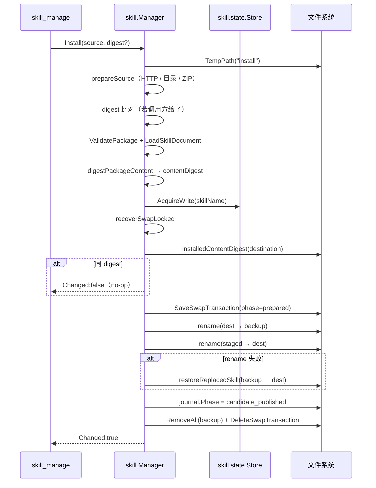

# Skill 安装与替换全链路

Skill 是「给模型读的说明文档 + 可选资源」。安装语义是**单目录原子替换**，没有版本目录、没有回滚槽位历史 —— 只有一个 journal 保证崩溃后可恢复。

## 触发点

| 触发方式 | 入口 | 说明 |
|---|---|---|
| MCP 工具 | `skill_manage` `action=install` | `internal/tool/skill/package.go:16` |
| CLI | `agentdock skill bootstrap --bundle <dir>` | 首启装载内置 4 个 Skill |
| Docker 入口 | `docker-entrypoint.sh` | `agentdock skill bootstrap --bundle /usr/local/share/agentdock/core-skills` |
| 直接 API | `skill.Manager.Install` | `internal/skill/install.go:42` |

`skill_manage` 的 5 个动作：`install`/`remove`/`env_set`/`env_unset`/`env_list`（`internal/tool/skill/contract.go:10`）。

## 数据流路径

逐节点：

| # | 节点 | 位置 | 关键动作 | 失败表现 |
|---|---|---|---|---|
| 1 | 参数校验 | `install.go:43-45` | `Source` 非空 | `ErrInvalidPackage` / `source` |
| 2 | 临时工作区 | `install.go:46-50` | `State.TempPath("install")`；`defer os.RemoveAll(work)` | `ErrInstallFailed` / `temp` |
| 3 | 取源 | `install.go:173 prepareSource` | HTTP(S) 下载 / 本地目录快照 / 本地 ZIP 快照 | `ErrInvalidPackage` + 阶段后缀 |
| 4 | 摘要比对 | `install.go:56-59` | 调用方给了 `DigestSHA256` 则必须一致 | `ErrDigestMismatch` |
| 5 | 包校验 | `install.go:60` | `ValidatePackage`（结构、文件数、大小） | `ErrInvalidPackage` |
| 6 | 读 SKILL.md | `install.go:64` | `LoadSkillDocument`：YAML frontmatter + 非空 body | 解析错误 |
| 7 | 内容摘要 | `install.go:68` | `digestPackageContent` 遍历目录算整体摘要 | `ErrInstallFailed` / `content_digest` |
| 8 | **写锁** | `install.go:77` → `skill/state/store.go:149` | `AcquireWrite(name)`；同 Skill 独占 | `ErrInstallFailed` / `lock` |
| 9 | 崩溃恢复 | `install.go:81` | `recoverSwapLocked` 清理上次残留的 journal/backup | `ErrInstallFailed` / `recover` |
| 10 | 目标路径 | `install.go:85` | `SkillPath(name)` = `<home>/skills/<name>` | `ErrInstallFailed` / `destination` |
| 11 | 当前摘要 | `install.go:89` | `installedContentDigest`；非目录或 symlink 直接报错 | `ErrInstallFailed` / `current_digest` |
| 12 | **幂等短路** | `install.go:94-96` | 存在且 digest 相同 → `Changed:false`，不写盘 | — |
| 13 | 备份路径 | `install.go:101` | `SwapBackupPath(name)`；残留 backup 视为异常 | `ErrInstallFailed` / `backup` |
| 14 | **journal 先落** | `install.go:110` | `SaveSwapTransaction(phase="prepared")` | `ErrInstallFailed` / `journal` |
| 15 | 旧版移走 | `install.go:113` | `os.Rename(dest, backup)` | 回删 journal；`ErrInstallFailed` / `backup` |
| 16 | **提交点** | `install.go:118` | `os.Rename(staged, dest)` | `restoreReplacedSkill` 恢复旧版 |
| 17 | journal 推进 | `install.go:124-128` | `Phase="candidate_published"` | 回滚 dest 并删 journal |
| 18 | 清理 | `install.go:130-136` | `RemoveAll(backup)` + `DeleteSwapTransaction`；失败只 `slog.Warn` | 下次 `recoverSwapLocked` 兜底 |

## 关键节点详解

### 三种来源归一

`prepareSource`（`install.go:173`）把三种输入变成同一种「已解压的目录 + 摘要」：

| 输入 | 处理 | 摘要来源 |
|---|---|---|
| `http(s)://` | 下载到 `work/package.zip`，`io.LimitReader(body, maxBytes+1)` 限流 | `DigestFile(archive)` |
| 本地目录 | `snapshotLocalDirectory` 快照到 `work/snapshot` | `DigestDirectory(candidate)` |
| 本地 ZIP | `snapshotLocalFile` 再 `prepareArchive` | `DigestFile(archive)` |

本地目录**不允许是 symlink**（`install.go:213-215`）。ZIP 解压后若顶层只有一个目录且含 `SKILL.md`，自动剥离这一层（`prepareArchive` 尾部）—— 兼容 GitHub 自动打包的 `repo-main/` 结构。

限额：`MaxDownload = 128 MiB`、`MaxFiles = 10000`（`install.go:33-34`）。

### journal 的两阶段语义与实际作用

`SwapTransaction`（`internal/skill/state/transaction.go:18`）只有 3 个必要字段：`Name`、`FromDigest`、`ToDigest`、`Phase`。

| Phase | 含义 | 恢复动作 |
|---|---|---|
| `prepared` | 已备份旧版，新内容可能已就位也可能没有 | 若 dest 存在 → 认为新内容已发布，删 backup；否则回滚 backup |
| `candidate_published` | 新内容确定在 dest | 删 backup 与 journal |
| 非法值 | — | `transaction.go:110` 直接报错 |

真正的**提交点**是 `os.Rename(staged, destination)` —— 一个 `rename(2)` 在同文件系统内是原子的。journal 只负责让崩溃后的恢复知道"该保留哪边"。

### 为什么没有版本目录

Skill 的使用者是模型：它读的是 `SKILL.md` 与同级资源。旧版本对模型毫无价值，保留多版本只会让 `agentdock_context` 的索引膨胀。因此 Skill 只有「当前内容」+ `content_digest`。

对比 Plugin：Plugin 内含 MCP 组件，运行中的进程持有旧版本文件句柄，必须保留版本目录 + 租约。→ 详见 [Plugin审核安装激活全链路](./Plugin审核安装激活全链路.md)

### 数据目录与 env scope 的分野

| Skill 来源 | 数据目录 | env scope |
|---|---|---|
| `managed`（本链路） | `config.SkillDataDir` = `<home>/data/skills/<name>` | `envstore.ScopeSkill` |
| `plugin`（Plugin 内附带） | `config.PluginSkillDataDir` = `<home>/data/plugins/<plugin>/skills/<name>` | `envstore.ScopePluginSkill` + `EnsureDataDir` + `PLUGIN_DATA_DIR` |

分野在 `Runtime` 的 `SkillLease` 构造时决定，`exec_command` 通过注入的 `SkillLease` 函数拿到正确的 env 注入。

`PLUGIN_DATA_DIR`、`SKILL_DATA_DIR` 是保留变量（`config/paths.go:12-13`），`IsReservedSkillEnvironmentKey`（`:100`）阻止用户通过 `env_set` 覆盖它们。

### 保留环境变量的删除语义

`Remove` 与 `RemoveWithPurge` 的区别：

| 方法 | 环境变量 | 数据目录 | 幂等 |
|---|---|---|---|
| `Remove`（`uninstall.go:11`） | 保留 | 保留 | 是 |
| `RemoveWithPurge`（`:19`） | 删除 | 删除 | 是（包已不存在也执行 purge） |

`RemoveWithPurge` 的注释（`:15-18`）明确：purge 在**同一个写锁内**执行，且包已缺失时仍执行 —— 这样"先 keep 再 purge"的两步操作可以安全重试。

## 异常路径

| 场景 | 位置 | 表现 |
|---|---|---|
| `source` 为空 | `install.go:43` | `ErrInvalidPackage` / `source` |
| 下载 HTTP 非 2xx | `install.go:188` | `ErrInvalidPackage` / `download` |
| 下载超 128 MiB | `install.go:203` | `package exceeds N bytes` |
| 本地源是 symlink | `install.go:213` | `local Skill source cannot be a symlink` |
| 源既非目录也非普通文件 | `install.go:231` | `must be a regular directory or ZIP file` |
| 摘要不匹配 | `install.go:56` | `ErrDigestMismatch` / `digest` |
| SKILL.md 缺失或 frontmatter 非法 | `install.go:64` | `ErrInvalidPackage` |
| 目标已是非目录 / symlink | `install.go:150` | `managed Skill destination is not a regular directory` |
| 残留 backup | `install.go:105` | `stale Skill swap backup remains after recovery` |
| `rename(staged, dest)` 失败 | `install.go:119-122` | `errors.Join(err, restoreErr)`；若恢复成功则删 journal |
| 写 journal 失败 | `install.go:110` | `ErrInstallFailed` / `journal`，磁盘未动 |
| 清理 backup 失败 | `install.go:132` | 只 `slog.Warn`；下次安装的 `recoverSwapLocked` 处理 |
| 读锁持有者崩溃 | `readerStaleAfter = 25h`（`store.go:24`） | 25 小时后视为陈旧并清理 |

**注意**：安装是"后写优先"，没有并发保护之外的语义。两个并发安装同一 Skill 会串行执行，后者若 digest 不同则覆盖前者 —— 这是设计选择，不是竞态。

## 关联组件

| 组件 | 参与方式 |
|---|---|
| `internal/skill/state` | 目录布局（`skills/`、`locks/skills/`、`tmp/skills/`、`state/skills/transactions/`）、读写租约、journal |
| `internal/skillspec` | `SKILL.md` 解析与命名规则（name ≤64，description ≤1024，ASCII 小写 + `-`） |
| `internal/envstore` | Skill 环境变量持久化（`env/skill/<name>.env`，0600） |
| `internal/tool/command` | 通过 `SkillLease` 把 `SKILL_DATA_DIR` 注入子进程 |
| `internal/config/paths.go` | 保留变量名与目录解析 |

## 相关业务流

→ 详见 [MCP工具调用全链路](./MCP工具调用全链路.md)（`skill_manage` 的请求如何到达这里）
→ 详见 [Plugin审核安装激活全链路](./Plugin审核安装激活全链路.md)（Plugin 内 Skill 的安装走 Plugin 链）
→ 详见 [自更新事务全链路](./自更新事务全链路.md)（`core-skills` bundle 随更新一起替换）
