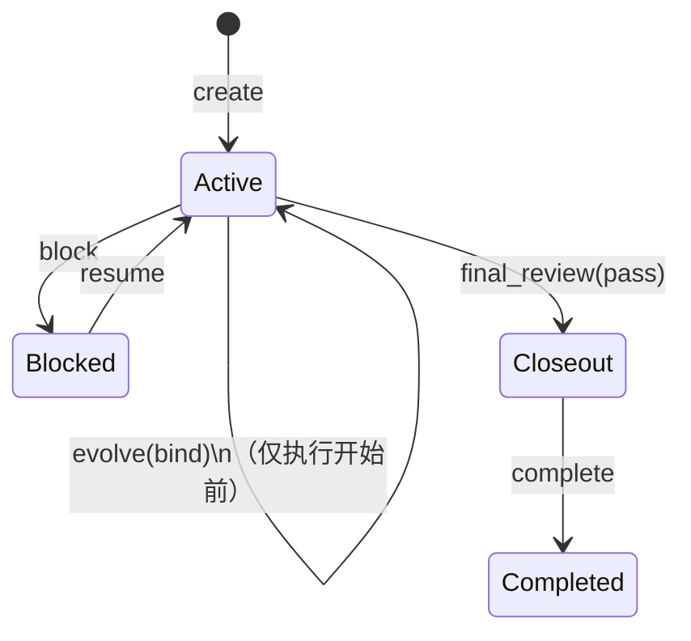
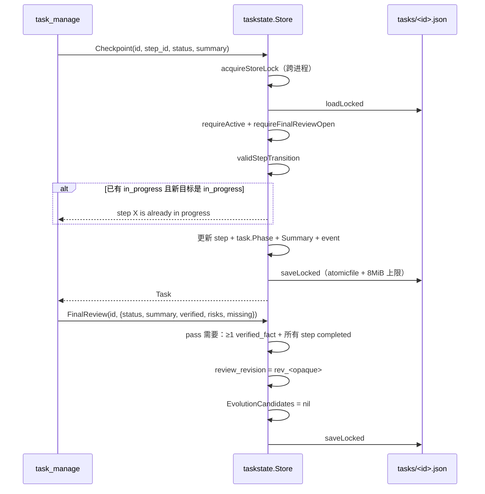

# 任务状态与演进绑定全链路

`task_manage` 把「一次多步工作」变成可恢复的持久状态机，并把它与自演化记录（Evolution）绑定 —— 但绑定受一条硬规则约束：**学过的东西不能给自己当证据**。

## 触发点

`task_manage` 8 个 action（`internal/tool/task/task_actions.go:12`）：

`create` | `list` | `get` | `checkpoint` | `block` | `resume` | `final_review` | `complete`

| action | 状态影响 | 是否需要已存在任务 |
|---|---|---|
| `create` | 新建 `active` | 否 |
| `list` | 无 | 否 |
| `get` | 无 | 是 |
| `checkpoint` | `Phase` 跟随 step；`Summary` | 是 |
| `block` | `active` → `blocked` | 是 |
| `resume` | `blocked` → `active` | 是 |
| `final_review` | 写 `FinalReview`；pass → `closeout` | 是 |
| `complete` | `active` → `completed` | 是（且必须 `closeout`） |

## 状态机



两维独立：

- **`Status ∈ {active, blocked, completed}`** —— 任务是否可继续。
- **`Phase ∈ {check, execute, verify, closeout}`** —— 走到哪一步。

`Phase` 不是客户端传的，而是从当前 `in_progress` 的 step 推导（`store_transition.go:59 task.Phase = step.Phase`）。`final_review` pass 时硬置 `closeout`（`:271`）。

## 数据流路径



| # | 节点 | 位置 | 关键动作 | 失败表现 |
|---|---|---|---|---|
| 1 | 加锁 | `store_transition.go:295 acquireStoreLock` | 文件锁（`store.go:38`） | 锁错误 |
| 2 | 读 | `store_read.go:16 Get` | JSON 解码 + 尺寸校验 | 不存在 / 损坏 |
| 3 | 可写检查 | `requireActive` / `requireMutable` | `completed` 不可变更 | 错误文案 |
| 4 | 终审闸门 | `requireFinalReviewOpen` | `FinalReview != nil` 时除 `complete` 外全禁 | 错误文案 |
| 5 | step 定位 | `store_transition.go:40-47` | 线性查找 | `task step %s not found` |
| 6 | 幂等短路 | `:56-58` | 状态与 summary 都没变 → 直接成功 | — |
| 7 | 转移校验 | `validStepTransition` | 见下表 | `cannot move step %s from %s to %s` |
| 8 | in_progress 唯一 | `:63-68` | 同时只能一个 step `in_progress` | `step %s is already in progress` |
| 9 | 失败终审作废 | `:71-73` | 任何 checkpoint 都会清掉 `failed` 的终审 | — |
| 10 | Phase 推导 | `:74` | `task.Phase = step.Phase` | — |
| 11 | 事件 | `appendTaskEvent` | 追加并裁剪到 256 条 | — |
| 12 | 落盘 | `store_read.go:99 saveLocked` | `atomicfile`；上限 8 MiB | 尺寸错误 |

### step 状态转移

| from \ to | pending | in_progress | completed |
|---|---|---|---|
| pending | ✓（幂等） | ✓ | ✗ |
| in_progress | ✓（回退） | ✓（幂等） | ✓ |
| completed | ✗ | ✗ | ✓（幂等） |

**completed 不可回退** —— 一旦某步标记完成，只能通过 `final_review(failed)` 之后的 checkpoint 重新组织（`failed` 终审会被清空，但 step 状态不回退）。

## 关键节点详解

### `final_review` 为什么要 VerifiedFacts

`applyFinalReview`（`store_transition.go:205`）的三条硬约束：

| status | 要求 |
|---|---|
| `pass` | ≥1 条 `verified_facts`；**所有 step 必须 completed** |
| `failed` | ≥1 条 `open_risks` 或 `missing_checks` |

这是防「空口宣称完成」的机制。`verified_facts` 是"我实际验证过什么"，不是"我认为应该没问题"。

`complete` 二次把关（`:199-206`）：必须 `FinalReview.Status == pass`，否则 `final_review must pass before complete`。

### `review_revision` 的作用

每次 `final_review` 生成新的 `rev_<opaque>`（`store_transition.go:258`），写进 `FinalReview.ReviewRevision`。`SetEvolutionCandidates` 要求调用方传入的 `review_revision` 与当前值精确匹配（`internal/taskstate/evolution.go:53-57`），不匹配直接拒绝。

意义：**演进候选必须锚定在某个具体的终审结论上**。如果终审被重做（新 revision），旧候选自动失效（`applyFinalReview` 里 `task.EvolutionCandidates = nil`，`:268`）。

### 演进绑定的防自证规则

`evolution.validateBinding`（`internal/evolution/service.go:333`）在三条拒绝路径之外，有一条关键的：

```go
if (check.OnSuccess == RelationSupport || check.OnFailure == RelationSupport) &&
   (taskGuided(task, record.EvolutionID) || taskDerivedFromEvolution(task, record.EvolutionID)) {
    return ..., ErrSelfProof
}
```

翻译：**如果这条演进记录曾经指导过这个任务（出现在 `GuidanceContext` 或 `EvolutionGuidanceSeen` 里），或者这个任务本身就是它派生出来的，那么这个任务不能反过来给它"support"证据**。

可以给 `contradict`（反证自己学到的规则是错的）—— 那是允许的，因为反证会削弱这条规则，不构成自证循环。

`GuidanceContext` / `EvolutionGuidanceSeen` 由 `SetGuidanceContext`（`evolution.go:30`）写入，后者是去重排序的 id 集合，只增不减。

### 绑定必须在执行前

`Store.BindEvolution`（`evolution.go:71`）检查 `taskExecutionStarted(task)`（`:123`）：

返回 true 的条件（任一）：
- `Status != active` 或 `Blocker != ""` 或 `FinalReview != nil` 或 `CompletedAt != nil`
- 任何 step 不是 `pending`
- 任何 event 不是 `created` / `templates_selected`

也就是说：**一旦你做了第一次 checkpoint，就不能再绑学习检查了**。这条规则防止"事后挑一条刚好被结果支持的规则来绑"。

数量上限 3（`service.go:311`）；同一 evolution 重复绑但语义不同 → 拒绝；完全相同 → 幂等成功。

### 存储限额

`internal/taskstate/model.go:13-21`：

| 字段 | 上限 |
|---|---|
| title | 512 B |
| goal | 16 KiB |
| 单个 completion condition | 4 KiB |
| completion conditions 数量 | 64 |
| summary / event summary | 8 KiB |
| 单条 review item | 4 KiB |
| review items 数量 | 每类 64 |
| events 数量 | 256（超出从头裁剪） |
| state 文件 | 8 MiB |

`events` 裁剪在 `store_read.go:103-104` 和 `:149-150`（读时也裁剪，兼容历史大文件）。

## 异常路径

| 场景 | 位置 | 表现 |
|---|---|---|
| 任务已完成再改 | `requireActive` | 拒绝 |
| 终审已存在再 checkpoint | `requireFinalReviewOpen` | 拒绝，必须 `complete` |
| step 不存在 | `store_transition.go:47` | `task step %s not found` |
| 非法转移（completed → 其它） | `validStepTransition` | `cannot move step ...` |
| 两个 in_progress | `:63-68` | `step %s is already in progress` |
| pass 但 step 未全完成 | `:244-246` | `passing final review requires all task steps completed: ...` |
| pass 但无 verified_facts | `:242-243` | `passing final review requires at least one verified fact` |
| failed 但无风险 | `:247-249` | `failed final review requires at least one risk` |
| 未 closeout 就 complete | `completeTask:290-292` | `task must reach closeout before completion` |
| 未 pass 就 complete | `:200-202` | `final_review must pass before complete` |
| 执行开始后绑演进 | `evolution.go:85-87` | `learning check must be bound before task execution starts` |
| 自证（guided/derived + support） | `evolution/service.go:353-355` | `ErrSelfProof` |
| 演进记录已 retired | `:348-350` | `retired evolution record cannot be bound` |
| 演进记录不适用本任务 | `:351-353` | `scope does not apply to this task` |
| review_revision 不匹配 | `taskstate/evolution.go:53-57` | `review_revision does not match current final_review` |
| summary 超限 | `validateTextLimit` | 带字段名的错误 |

## 关联组件

| 组件 | 参与方式 |
|---|---|
| `internal/taskstate` | Task/Step/Event/FinalReview 模型、8 个转移、限额、文件锁 |
| `internal/evolution` | `propose`/`bind`/`supersede`/`retract` 四 intent；`ValidateBindings` 批量校验 |
| `internal/tool/task` | `task_manage` 契约与参数归一；`workflow_template_manage` 7 个 action |
| `internal/mcp/apps.go` | TaskProgress 卡片（MCP Apps） |
| `internal/app/runtime_api.go` | `RuntimeTasks` 只读列表给桌面端 |

## 相关业务流

→ 详见 [MCP工具调用全链路](./MCP工具调用全链路.md)（`task_manage` 的入口）
→ 详见 [Plugin审核安装激活全链路](./Plugin审核安装激活全链路.md)（三级租约 vs 任务的文件锁）
→ 详见 [Skill安装与替换全链路](./Skill安装与替换全链路.md)（共享 `atomicfile` 原语）
