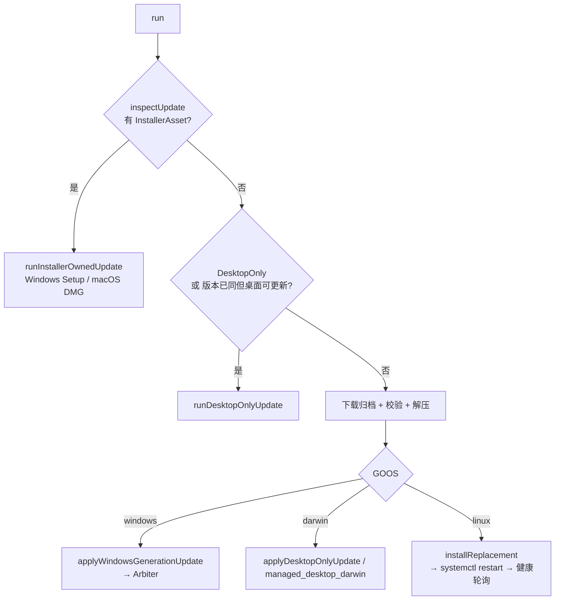
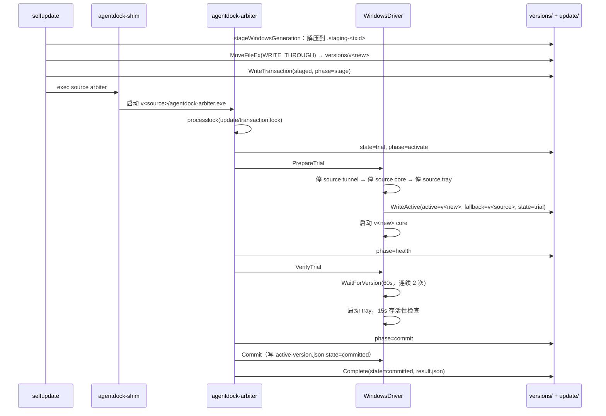

# 自更新事务全链路

自更新最难的约束：**进程不能替换自己正在执行的二进制**。Windows 上文件被占用时连 `rename` 都不允许；Linux 靠 inode 语义可以覆盖；macOS App Bundle 可整体换。

因此 AgentDock 有四条路径，按平台与安装形态分派。

## 触发点

| 触发方式 | 入口 | 位置 |
|---|---|---|
| CLI | `agentdock update` | `cmd/agentdock/main.go:49` → `selfupdate.Run` |
| CLI（检查） | `agentdock update --check` | `main.go:51` → `selfupdate.Check` |
| CLI（进度） | `agentdock update --progress` | `main.go:58` → `RunWithProgress` |
| CLI（离线归档） | `agentdock update --local-archive <zip>` | `main.go:62` → `RunLocalArchive`（仅 Windows） |
| 托盘 | macOS/Windows 桌面端"检查更新" | 调 `agentdock update` 子进程 |
| 内部 | `__apply-update` 等内部命令 | `selfupdate.HandleInternalCommand`（`main.go:28`） |

## 路径分派



| 路径 | 适用 | 事务机制 | 回滚槽 |
|---|---|---|---|
| Windows generation | Windows 主程序 | `versions/v<semver>/` + `active.json` + Arbiter | 上一 generation |
| Windows Setup | 有 InstallerAsset | 交给 Inno Setup，`HandedOff` 退出 | Setup 自己的备份 |
| macOS App-managed | macOS App Bundle | Arbiter + `RENAME_SWAP` | 旧 `.app`（原位置即槽位） |
| Linux 覆盖式 | Linux 二进制 | 备份 + rename + 健康轮询 | `*.agentdock-backup` |

## 一、检查与下载（所有路径共用）

| # | 节点 | 位置 | 关键动作 |
|---|---|---|---|
| 1 | 清单拉取 | `update.go:578 fetchLatestReleaseManifest` | 默认 `https://download.nexusdock.co/latest.json` |
| 2 | 平台资产选择 | `update.go:783 platformAssetNames` / `:799 windowsSetupAssetName` | 按 GOOS/GOARCH 匹配 |
| 3 | 版本比较 | `update.go:826 compareVersions` | 支持 prerelease 序 |
| 4 | 下载 | `update.go:608 downloadWithProgress` | 归档上限 256 MiB |
| 5 | 校验 | `update.go:677 verifyChecksum` | `SHA256SUMS.txt`，1 MiB 上限 |
| 6 | 解压 | `update.go:696 extractExecutable` | 提取载荷上限 64 MiB |
| 7 | 版本自证 | `update.go:751 verifyBinaryVersion` | 跑 `--version`，15s 超时 |

上限常量集中在 `update.go:29-37`：release archive 256 MiB、desktop 512 MiB、installer 512 MiB。

第 7 步是关键：**先证明新二进制能跑起来并报出目标版本**，再让它替换旧版。这挡掉了"下载成功但资产错位/架构不匹配"的一整类问题。

## 二、Windows generation 路径

### 目录布局

```
<install>/
  bin/agentdock.exe            ← stable shim（永不替换内容，只换它指向的 generation）
  bin/agentdock-tray.exe       ← stable tray shim
  versions/v1.0.0/agentdock-core.exe
  versions/v1.0.0/agentdock-tray.exe
  versions/v1.0.0/agentdock-arbiter.exe
  versions/v1.0.0/core-skills/
  update/transaction.json      ← journal
  update/active-version.json   ← 当前激活指针
  update/result.json
```

常量在 `internal/updateengine/layout.go:10-15`，路径方法 `:34-56`。

### 事务时序



| # | 节点 | 位置 | 关键动作 |
|---|---|---|---|
| 1 | 暂存 | `generation_windows.go:152 stageWindowsGeneration` | `.staging-<txid>` 目录 |
| 2 | 换入 | `generation_windows.go:212-223` | `MoveFileEx(WRITE_THROUGH)` —— 断电安全 |
| 3 | journal | `generation_windows.go:105 WriteTransaction` | `State=staged`, `Phase=stage` |
| 4 | 拉起仲裁器 | `generation_windows.go:111-113`、`managed_desktop_darwin.go:130-135` 同构 | **用 source generation 的 arbiter**，不是新的 |
| 5 | 互斥 | `arbiter.go:37-42` | `processlock` on `update/transaction.lock` |
| 6 | 状态分派 | `arbiter.go:53-58` | `staged`→trial；`trial`/`rolling_back`→recover；终态→读 result |
| 7 | trial 起手 | `arbiter.go:66-74` | 先写 `state=trial, phase=activate` 再动系统 |
| 8 | 停旧 | `updateplatform/windows.go:40 PrepareTrial` | 顺序：tunnel → core → tray；全部通过 **source** 执行 |
| 9 | 切指针 | `windows.go:68-76` | `WriteActive(active=target, fallback=source, state=trial)` |
| 10 | 启新 | `windows.go:77-81` | 只在原 core 在跑时启 |
| 11 | 健康 | `updateengine/health.go:18 WaitForVersion` | 每端点需**连续 2 次**命中；HTTP 超时 2s；`/healthz` 500ms 轮询 |
| 12 | Tray 检查 | `windows.go:95-101` | 15s 进程存活 |
| 13 | Tunnel 排除 | `windows.go:104-106` | 注释：Tunnel 是软依赖，commit 后才异步重启 |
| 14 | 提交 | `arbiter.go:83` → `windows.go:109 Commit` | 写 `active-version.json` state=committed |
| 15 | 收口 | `arbiter.go:86-102` → `store.go:180 Complete` | 写 `result.json`，`State=committed` |
| 16 | GC | `generation_windows.go:239-256` | 删旧 generation，保留 fallback |

### 为什么停旧必须用 source generation

`windows.go:52-53` 的注释：「所有停止动作都仍通过 source generation 执行。只有旧 Core/Tunnel/Tray 完整退出后才切 active pointer，避免同一端口被两个 generation 竞争。」

如果先切指针再停，shim 会把新 core 拉起来，同时旧 core 还占着端口 —— 新 core 启动失败，而指针已经指向它。

### shim 的崩溃恢复

`cmd/agentdock-shim/main_windows.go:243 installerOwnsActiveTrial`：shim 每次启动都检查 `update/transaction.lock`，若存在未完成的 trial 且安装器持有（`:267`），重放崩溃恢复（`:333-350`）。这样"更新到一半断电"下次开机自动收敛。

## 三、macOS App-managed 路径

| # | 节点 | 位置 | 关键动作 |
|---|---|---|---|
| 1 | 准备 | `managed_desktop_darwin.go:65` | `NewTransaction`（平台白名单仅 windows+darwin） |
| 2 | staging 锁 | `:49` | 防止两个更新同时暂存 |
| 3 | transaction 锁 | `:54-61` | 跨进程互斥 |
| 4 | 暂存副本 | `:85 stageMacOSApp` | 新 `.app` 放到 trial 路径 |
| 5 | 仲裁器副本 | `:86 copyKnownGoodMacOSArbiter` | 把**当前**可用的 arbiter 复制进 trial，确保新 App 有问题时仲裁器仍能工作 |
| 6 | journal | `:112 WriteTransaction` | — |
| 7 | 执行 | `:134-140` | exec arbiter；读 `result.json` |
| 8 | 清理 | `:145-152` + `:220-230` | 仅在 terminal result 之后 |

macOS driver：

| 阶段 | 位置 | 行为 |
|---|---|---|
| `PrepareTrial` | `updateplatform/darwin.go:60` | `RENAME_SWAP`（`swap_darwin.go:28`）原子换位 |
| `VerifyTrial` | `:102` | handoff 60s；txid + version 双校验（`:437`）；enabled → 健康 45s；`requires_approval` → 只给 warning |
| `Commit` | `:138` | **空实现** —— 旧 `.app` 就是天然回滚槽，commit 只是不再需要它 |
| `Rollback` | `:144` | 安全态证明（`:222-243`）后换回 |
| 签名连续性 | `:307-357` | 新 App 与旧 App 必须同签名主体 |

**为什么 `Commit` 是空的**：macOS 上"已提交"等于"不再需要旧槽位"。清理由 `managed_desktop_darwin.go` 在拿到 terminal result 后统一做，避免在 Arbiter 里删自己脚下。

## 四、Linux 覆盖式路径

| # | 节点 | 位置 | 关键动作 |
|---|---|---|---|
| 1 | 入口 | `apply_unix.go:31 applyPlatformUpdate` | — |
| 2 | 替换 | `:63 installReplacement` | rename 新文件到位，旧文件改名成 backup（`:286-293` 内含 fsync） |
| 3 | 回滚闭包 | `:67` | 失败时 `:328 restoreBackup` |
| 4 | 版本自证 | `:102 verifyBinaryVersion` | 再跑一次 `--version` |
| 5 | 重启 | `:107 restartManagedService` → `:241` 实现 | `systemctl --user restart` |
| 6 | 健康 | `:252 WaitForRestart` 30s / `:255 waitForVersion` 30s | — |
| 7 | 签名 | `:99 signLocalReplacement` | 本地自签校验（`service_linux.go:78`） |

Linux **没有** `active-version.json`、没有 generation、没有 Arbiter。因为 `rename(2)` 可以覆盖运行中的二进制（旧 inode 由内核持有到进程退出），备份 + 健康检查足够。

服务名与端口发现：`selfupdate/service_linux.go:15`（systemd 服务名）、`:49-70 HealthCandidates`（从 `/proc/<pid>/environ` 读 `AGENTDOCK_PORT`）。

## 五、离线归档路径（`--local-archive`）

`local_archive.go:19 RunLocalArchive`，**仅 Windows**（`:20-22`）。用途：企业内网无外网时的旁路更新。

| 步骤 | 位置 | 限额/校验 |
|---|---|---|
| 归档大小 | `:34` | 512 MiB |
| checksum 文件 | `:39` | 1 MiB |
| 校验 | `:48` | SHA-256 |
| 解压 | `:61`、`:69` | — |
| 版本自证 | `:73` | — |
| 桌面载荷 | `:76` | 可选 |
| 应用 | `:82` | — |
| 交接 | `:95-97` | `HandedOff` 报错（Setup 接手后不再返回） |

Authenticode：`installer_update_windows.go:45` 用 `authenticode.VerifyFileOrSameSigner`；`:53-59` 静默参数。

## 六、回滚触发码表

`arbiter.go` 是唯一的回滚决策点，`code` 直接进 `result.json`：

| 码 | 触发条件 | 位置 |
|---|---|---|
| `trial-activation-failed` | `Driver.PrepareTrial` 失败 | `arbiter.go:73` |
| `trial-journal-failed` | 写 `phase=health` 失败 | `:79` |
| `trial-verification-failed` | `Driver.VerifyTrial` 失败（健康/版本/tray） | `:84` |
| `commit-journal-failed` | 写 `phase=commit` 失败 | `:91` |
| `commit-failed` | `Driver.Commit` 失败 | `:95` |
| `trial-interrupted` | 启动时发现 `state=trial` 或 `rolling_back` | `:54`、`:105-106` |
| `rollback-failed` | 回滚本身失败 → `State=failed` | `:121-134` |

**`rollback-failed` 的特殊处理**（`arbiter.go:130-134`）：即使回滚失败，`ActiveVersion` 仍被写成 `SourceVersion` 并落 `State=failed`。因为物理文件大概率已经换回（恢复逻辑通常在中途失败），journal 必须如实反映"我认为现在是旧版本"。

### 回滚的独立预算

`arbiter.go:105-119`：

```go
rollbackCtx, cancel := context.WithTimeout(context.WithoutCancel(ctx), rollbackRecoveryTimeout) // 3min
```

注释原文解释了必要性：「trial 在超时边缘失败时，rollback 会拿到已经取消的 context，导致'物理上已换回旧版本、journal 却记为 failed'的半恢复状态。」

`rollbackRecoveryTimeout = 3 * time.Minute`（`arbiter.go:25`）；Arbiter 进程整体预算 4 分钟（`cmd/agentdock-arbiter/main.go:78`）。

## 七、桌面端（Tray / App）更新与 Core 更新正交

| 层 | 更新方式 | 与 Core 的关系 |
|---|---|---|
| Core（Go 二进制） | 上述四条路径 | — |
| macOS App（Swift） | 下载 DMG / `.app` 归档，交给 `DesktopApply` | 可单独更新，版本号独立 |
| Windows Tray（Go） | 随 generation 一起替换；Setup 路径下独立 | `desktop-version.txt` 记录 |

`selfupdate` 的判断：`DesktopOnly || (DesktopUpdateAvailable && 当前版本 == 最新版本)` → 只更新桌面（`update.go:220-222`）。

macOS 桌面：`desktop_apply_darwin.go:55 prepareDesktopUpdate` → `.new`/`.backup`（`:79-80`）→ `:203 Commit` / `:138 Restore` / `:173 Finish`；日志 `:322 update.log`，结果 `:481 update-result.json`。
Windows 桌面：`desktop_apply_windows.go:199-200` 备份 → `:242 Install` → `.new`（`:251`）→ `.rollback`（`:284-286`）→ 清理（`:336-338`）；`desktop_update_windows.go:24-27` 要求 `agentdock-tray.exe` + `agentdock.ico` 齐全。

## 异常路径

| 场景 | 表现 |
|---|---|
| 清单不可达 | `run` 直接返回错误，本地不动 |
| 无更新 | 打印消息 + 发 `completed` 事件，退出 0 |
| checksum 不符 | `更新文件校验失败，当前版本未被修改` |
| 新二进制跑不出目标版本 | `verifyBinaryVersion` 失败，**不替换** |
| `MoveFileEx` 失败 | generation 未换入，旧版继续工作 |
| trial 超时 | `trial-verification-failed` → 回滚 |
| 回滚也失败 | `State=failed`，`ActiveVersion=source`，需要人工介入 |
| 更新到一半断电 | 下次 shim 启动重放恢复（`main_windows.go:333-350`） |
| `v1.0.0` 发布漏设 `LEGACY_GITHUB_LATEST_TAG` | v0.9.1 客户端跳过兼容桥，收不到更新（`release.yml:1547-1548`） |
| 桌面端 `requires_approval`（macOS 新签名主体） | trial 只给 warning，等用户手动确认 |

## 关联组件

| 组件 | 参与方式 |
|---|---|
| `internal/updateengine` | 状态机、journal、active pointer、健康检查、Arbiter |
| `internal/updateplatform` | 平台驱动（Windows / darwin） |
| `internal/selfupdate` | 下载、校验、解压、交接、离线归档、桌面更新 |
| `internal/installer` | 首装与服务激活（与自更新共用 journal 原语） |
| `cmd/agentdock-arbiter` | 独立仲裁器进程 |
| `cmd/agentdock-shim` | Windows 稳定入口 + 崩溃恢复 |
| `internal/component` | cloudflared 独立版本化（与主更新正交） |

## 相关业务流

→ 详见 [Nexus配对与隧道全链路](./Nexus配对与隧道全链路.md)（cloudflared 组件更新）
→ 详见 [Skill安装与替换全链路](./Skill安装与替换全链路.md)（`core-skills` bundle 随 generation 替换）
→ 详见 [插件与 Skill 的差异](../02-功能结构和策略/关键设计决策.md)（D8/D9 的取舍理由）
