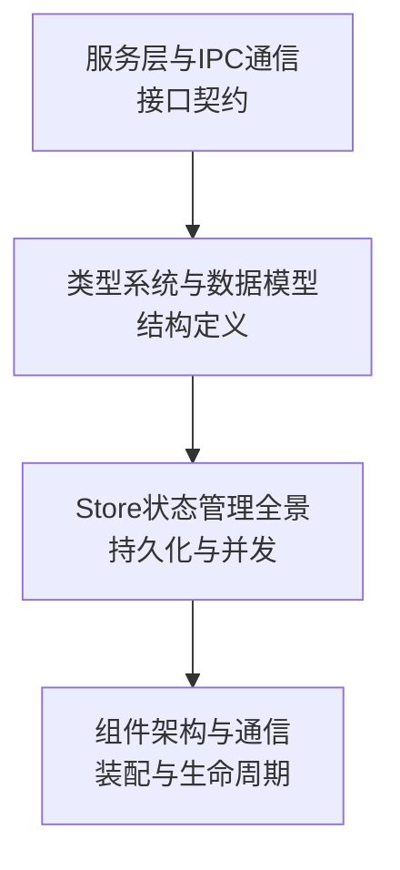

# 04-数据与组件设施 索引

四篇：状态载体、组件装配、接口契约、数据模型。**字段级与 API 级细节的唯一落点**，其它分类只做引用。

## 文档清单

| 文档 | 回答什么 | 关键内容 |
|---|---|---|
| [Store状态管理全景](./Store状态管理全景.md) | 状态存在哪、谁能改、怎么并发 | 11 个 Store 的目录布局、锁模型、stale 值、上限 |
| [组件架构与通信](./组件架构与通信.md) | 代码怎么组织、进程怎么划分 | `app.Runtime` 组合根、31 工具子包、双栈桌面端、通信拓扑 |
| [服务层与IPC通信](./服务层与IPC通信.md) | 对外接口有哪些、限额多少 | HTTP 路由全表、Runtime API、MCP 传输、本地控制、Nexus Bridge、ACP |
| [类型系统与数据模型](./类型系统与数据模型.md) | 结构体字段与约束 | `ToolError`、`Task`、`Record`、`State`、`Transaction`、`Identity` |

## 分层读法

先看接口有哪些 → 再看结构长什么样 → 再看怎么存 → 最后看谁把它装起来。

## 关键事实速查

| 问题 | 答案 | 权威位置 |
|---|---|---|
| 状态根目录 | `~/.agentdock`（0700） | Store §全局约定 |
| 单任务状态上限 | 8 MiB | Store §1 |
| 读者 stale 判定 | 25 小时 | Store §4、§5 |
| 工具总数 | 31 | 组件架构 §工具层 |
| MCP 请求体上限 | 1 MiB | 服务层 §1 |
| Runtime API 默认超时 | 8s（resource-library 2min） | 服务层 §2 |
| Nexus 单条消息上限 | 8 MiB | 服务层 §6 |
| 演进绑定上限 | 3 条 | 类型系统 §3 |

## 相关分类

→ 详见 [架构总览](../01-架构总览/README.md)
→ 详见 [功能结构与策略](../02-功能结构和策略/README.md)
→ 详见 [核心数据业务流](../03-核心数据业务流/README.md)
→ 详见 [总索引](../README.md)
