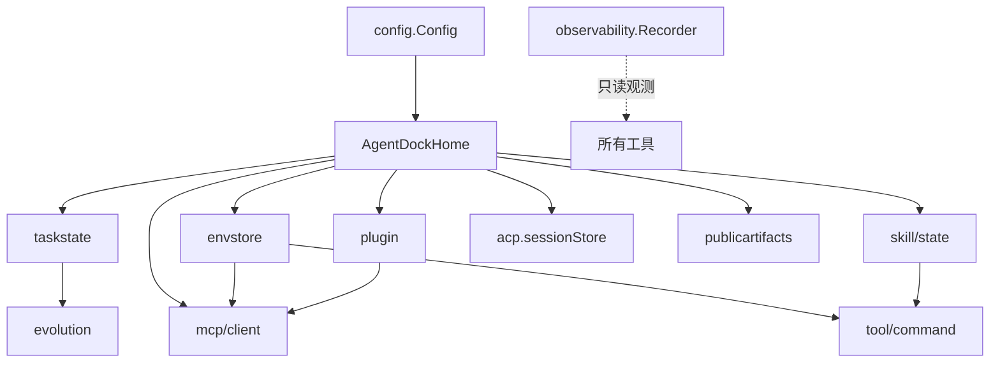

# Store 状态管理全景

AgentDock 是 Go 服务，无前端状态库。此处的「Store」指**进程内状态 + 磁盘持久化**的十一个载体。本文是它们并发语义与目录布局的唯一权威位置；字段定义见 [类型系统与数据模型](./类型系统与数据模型.md)。

## 全局约定

| 维度 | 约定 | 位置 |
|---|---|---|
| 根目录 | `~/.agentdock`；工作区默认 `~/AgentDock` | `config.go:213-218` |
| 目录权限 | `0700`，启动期强制 `EnsurePrivate` | `config.go:231-243` |
| 文件权限 | `0600` | `envstore/store.go:247`（`atomicfile.Write(..., 0o600)`） |
| 原子写 | 临时文件 + rename + 目录 fsync | `fs/atomicfile/write.go:12` |
| 跨进程锁 | `flock`/`LockFileEx`，stale 判定 10 分钟 | `fs/filelock/filelock.go:34,229` |
| 进程单例锁 | `processlock`（update/install 事务） | `fs/processlock/lock.go:17` |
| Schema | 每个持久结构带 `schema_version` | 各 `types.go` |

## 十一个 Store

| Store | 位置 | 持久化 | 并发模型 | 用途 |
|---|---|---|---|---|
| `taskstate.Store` | `<home>/tasks` | `tasks/<id>.json` | 文件锁 + `mutate` | 任务状态机 |
| `envstore.Store` | 按 scope | `.env` 风格文件 | `sync.Mutex` + 文件锁 | Secret / 环境变量 |
| `workspace.Workspace` | 用户目录 | 无 | 无（只读约束器） | 路径解析 |
| `skill/state.Store` | `<home>/skills` | 目录 + `transactions/*.json` | 读写租约 | Skill 安装 |
| `plugin.Store` | `<home>/plugins` | `state.json` + `packages/` | 三级租约 | Plugin 生命周期 |
| `observability.Recorder` | 内存 | 无（环形 500） | `sync.RWMutex` | 执行记录 |
| `observability.Tracing` | 内存 | 无 | OTel SDK | Span |
| `nexusbridge.ConnectionState` | 内存 | 无 | `sync.RWMutex` | 握手状态 |
| `publicartifacts.Store` | `<home>/artifacts` | 文件 + HMAC | 文件系统 | 对外产物 |
| `mcp/client.Manager` | `<home>/mcp.json` + `data/mcp/` | JSON + grant | `sync.Mutex` + per-server | 外部 MCP |
| `acp.sessionStore` | `<home>/acp/<agent>/sessions` | `sessions/<id>.json` | 目录级 | ACP 会话 |

## 1. `taskstate.Store`

`store.go:16 Store` / `:21 New`。单任务一文件，上限 8 MiB。

**并发模型**：所有写走 `mutate`（`store_transition.go:294`）：

```go
release, err := s.acquireStoreLock()   // store.go:38
defer release()
task, err := s.loadLocked(id)
// fn(task, now) 纯内存变换
// saveLocked → atomicfile.Write
```

`fn` 报错则不落盘 —— "读-改-写"的原子性来源。

**读有副作用**：`Get`/`List` 会裁剪超过 256 条的事件（`store_read.go:103-104`、`:149-150`），读取不是纯净的。

## 2. `envstore.Store`

三个 scope（`store.go:19-26`）：

| Scope | `Name` | `Plugin` | 谁读 |
|---|---|---|---|
| `skill` | skill 名 | — | managed Skill 的 `exec_command` |
| `plugin_skill` | skill 名 | plugin 名 | plugin 内 Skill |
| `mcp` | server 名 | — | 外部 MCP server 的 stdio env / header |

| 方法 | 语义 | 位置 |
|---|---|---|
| `Path(scope)` | scope → 物理文件；作用域概念的唯一实现点 | `:73` |
| `Set` | 校验保留 key + UTF-8，整文件重写 | `:107` |
| `List` | 只返回 `{Key, Configured}`，**永不返回 value** | `:157` |
| `Load` | 内部用，返回 map | `:174` |
| `RemovePluginSkillScopes` | 删插件时连带清 env | `:83` |

格式 `.env` 风格，`shellQuote` 处理引号换行；文件上限 1 MiB。每次写后重新施加 0600。

## 3. `workspace.Workspace`

不是存储，是**路径约束器**（`workspace.go:12`）。

| 方法 | 语义 | 位置 |
|---|---|---|
| `ResolveExisting` | 必须存在，`EvalSymlinks` 后校验在 root 内 | `:84` |
| `ResolveForWrite` | 允许不存在，父目录须真实 | `:88` |
| `Relative` | root 内给相对路径；越界**返回绝对路径**（不报错） | `:171` |
| `Clean` | `filepath.Clean` + `IsLocal` | `:191` |
| `Hidden` | 点文件判定 | `:204` |

`Clean` 注释明示**不是安全边界**；真边界是 `os.OpenRoot`/`OpenInRoot`（陷阱 A5）。`ResolveForWrite` 在 `EvalSymlinks` 与写入之间有 TOCTOU 窗口（陷阱 A5）。

## 4. `skill/state.Store`

| 常量 | 值 | 位置 |
|---|---|---|
| `lockRetryInterval` | 25ms | `store.go:21` |
| `readerStaleAfter` | 25h | `:22` |
| `readerOwnerPrefix` | `reader-` | `:23` |

**布局**（`New`，`:29`）：内容 `<home>/skills`、锁 `<home>/locks/skills`、暂存 `<home>/tmp/skills`、journal `<home>/state/skills/transactions`。

| 方法 | 语义 |
|---|---|
| `AcquireRead`/`acquireRead`（`:145`/`:153`） | 多读者，标记文件 `reader-<pid>-<nonce>` |
| `AcquireWrite`（`:149`） | 独占 |
| `Resolve`（`:120`） | 名字 → 版本化目录 |

读者崩溃后标记文件 25h 才算 stale —— 保守值，避免误杀长跑读者，代价是崩溃后回收延迟。

**事务**（`skill/state/transaction.go:18`）：`Phase` 仅 `prepared`（`:110` 校验）与 `candidate_published` 两值。

## 5. `plugin.Store`

布局（`ensureLayout`，`store.go:86`）：

```
<home>/plugins/
  <name>/state.json          ← 不含 MCP 明文
  <name>/packages/<version>/
  <name>/data/
  <name>/activation/<owner>.json
  locks/ tmp/ update-backups/ update-candidates/<owner>/
```

**三级租约**（最精细的并发设计）：

| 方法 | 持有范围 | 位置 |
|---|---|---|
| `AcquireBinding` | **仅** `state → version` 解析窗口 | `:457` |
| `AcquireWrite` | 独占写 | `:554` |
| `AcquireVersionRead` | 针对具体版本的读 | `:615` |
| `WaitVersionIdle` | 等引用归零 | `:658` |
| `RemoveVersionIfIdle` | 引用为 0 才删 | `:691` |

`AcquireBinding` 注释原文：「protects only the brief state->version binding window. Long-running Plugin work must use AcquireVersionRead after resolving state.」—— 拿到具体版本后必须升级，否则 GC 会在使用期间删掉它。

另有两处细节：stale 判定 25h（`:29`、`:820`）；`localLock`（`:748`）给每个插件名一个进程内 `sync.RWMutex`，与文件锁叠加（文件锁防跨进程，本地锁省系统调用）。

## 6. `observability.Recorder`

纯内存环形缓冲，容量 500（`recorder.go:11`）。满后覆盖最旧 —— 高频调用下只反映最近窗口，可接受因为它是诊断而非审计。

| 方法 | 位置 |
|---|---|
| `NewRecorder` | `:75` |
| `BeginTool` / `EndTool` | `:86` / `:95` |
| `Snapshot` | `:167` |
| `RecordStage`（单次执行上限 16） | `stage.go:59` |
| `AddStageEvents` / `CloseExecution` | `:95` / `:112` |

`validStage`（`stage.go:136`）白名单过滤，未知阶段丢弃而非报错。`Tracing` 独立（otel 薄封装，默认 no-op），与 Recorder 无依赖。

## 7. `nexusbridge.ConnectionState`

一个 bool + `sync.RWMutex`（`connection_state.go:5-15`）。故意最小化：重连、退避、心跳都在 `Client.Run` 循环里，状态对象只被 `/internal/runtime/status` 与桌面端读取。

## 8. `publicartifacts.Store`

`store.go:20 Store`；`Metadata` 见 [类型系统](./类型系统与数据模型.md#8-产物与-acp)。

**签名**（`signing.go:101`）：`HMAC-SHA256(secret, "<id>\n<filename>\n<expires>\n<sha256>")`，URL 形如 `/artifacts/public/<id>/<name>?expires=<unix>&sig=<hex>`。四元组绑定，改任一字段即失效。

`EnsureSecret`（`:219`）启动期创建/读取密钥，失败即启动失败（`httpx/server.go:34-39`）；`Cleanup(now)`（`cleanup.go:12`）删过期产物。保留期默认 24h、上限 7 天，非法值静默夹取而非报错。

## 9. `mcp/client.Manager`

两层配置：

| 层 | 来源 | 写入方 |
|---|---|---|
| standalone | `mcp.json` 的 `mcpServers` | 用户手写 |
| owned | Plugin 声明的 MCP server | `SetOwnedServers`（`:107`） |

`mergeOwned`（`:165`）合并；`buildOwnedRegistry`（`:129`）检同名冲突。`syncRegistry`（`:346`）差量重建：新增连接、删除关闭、未变保留。

OAuth：`Authorize`（`:417`）→ `watchAuthorization`（`:485`）后台等回调 → `DeliverOAuthCallback`（`:453`）。凭证明文落 `data/mcp/clients.json` 与 `grant-*.json`（陷阱 A4）。

读方法：`List`（`:366`）、`EnabledIndex`（`:384`）、`Inspect`（`:395`）、`Search`（`:575`）、`InspectTool`（`:639`）、`Call`（`:658`，调用前 `ensureTools` 刷新工具表）。

## 10. `acp.sessionStore`

每 agent 独立目录（`storeRoot`，`store.go:190`）：`<home>/acp/<agent>/sessions/`。

| 方法 | 语义 | 位置 |
|---|---|---|
| `Save` | 原子写 | `:49` |
| `Get` | 读 + `validateSessionRecord` | `:55` |
| `List` / `Delete` | — | `:61` / `:84` |
| `markInterrupted` | 启动时把上次未结束会话标 interrupted | `:97` |

`markInterrupted` 是崩溃恢复：重启后 `running` 历史会话不可续用。`validateSessionRecord`（`:197`）校验 id 一致性与字段完整性 —— 防手改文件或版本升级错位。

## 依赖与选锁



`envstore` 被 `mcp/client` 与 `tool/command` 共用，是"配置 → 执行"的桥梁。

| 需求 | 选择 | 理由 |
|---|---|---|
| 单文件读改写 | `taskstate.mutate` | 天然原子 |
| 多读者 + 独占写 | `skill/state` 读写租约 | 读不互阻 |
| 短绑定后长任务 | `plugin` Binding → VersionRead | 防 GC 误删 |
| 进程级单次事务 | `processlock` | 跨进程，不依赖 FS 锁语义 |
| 纯内存共享 | `sync.RWMutex` | ConnectionState、Recorder |
| 全局配置 | `sync.Mutex` | envstore、mcpclient |

## 相关文档

→ 详见 [组件架构与通信](./组件架构与通信.md)（组合根如何装配）
→ 详见 [类型系统与数据模型](./类型系统与数据模型.md)（字段定义）
→ 详见 [Plugin审核安装激活全链路](../03-核心数据业务流/Plugin审核安装激活全链路.md)（三级租约真实用法）
→ 详见 [Skill安装与替换全链路](../03-核心数据业务流/Skill安装与替换全链路.md)（读写租约真实用法）
