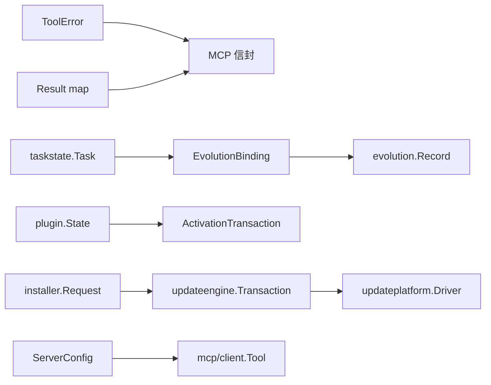

# 类型系统与数据模型

三层：**错误与结果**（全工具共用）、**领域模型**（各 Store 私有）、**事务契约**（跨进程持久化）。字段级定义在此，行为语义见 [Store状态管理全景](./Store状态管理全景.md)。

## 1. 错误与结果

### `ToolError`

`internal/tool/core/core.go:19`：

| 字段 | JSON | 语义 |
|---|---|---|
| `Code` | `code` | 大写下划线错误码：`INVALID_ARGUMENT`、`PERMISSION_REQUIRED`、`UNKNOWN_TOOL` |
| `Message` | `message` | 人类可读，英文，不含路径/凭据 |
| `Category` | `category` | `validation`→400，`not_found`→404，其它→500（`httpx/runtime_api.go:98-111`） |
| `Retryable` | `retryable` | 网络类 true，参数类 false |
| `Details` | `details` | 结构化补充，如 `{"reason":"..."}` |
| `cause` | — | 未导出，`Unwrap()` 暴露 |

构造器 `core.go:31-40`：`NewError`、`NewErrorDetails`、`NewErrorCause`。
`internal/app/errors.go:5`：`type ToolError = toolcore.ToolError` —— 同一类型两个名字。

**`Category` 是唯一影响 HTTP 状态码的字段**；MCP 侧不看它，一律 HTTP 200 + `isError`。

### `Result`

`type Result map[string]any`（`core.go:17`），无泛型约束，形状由 **output schema** 描述。代价：output schema 不做运行时校验（只编译 input validator，`specs_validation.go:16`），"统一 Schema 校验"须限定为"输入侧 + 启动期 fail-fast"（陷阱 F1）。

### MCP 信封

`mcp/server.go:274-305`：成功 → `content:[{type:"text",text:<json>}]` + `structuredContent` + `isError:false`；失败 → `isError:true`，`content` 内为 `{"error":{code,message,category,details}}`。

### 各层错误类型

| 包 | 类型 | 位置 | 关系 |
|---|---|---|---|
| `tool/core` | `ToolError` | `core.go:19` | 基准 |
| `app` | `ToolError` | `errors.go:5` | 类型别名 |
| `mcp/client` | `Error` | `types.go:82` | 独立；`tool/mcp` 层归一 |
| `acp` | `Error` | `types.go:37` | 独立；`tool/acp` 层归一 |

不统一是刻意的：`mcp/client` 与 `acp` 是与外部进程的边界，需携带协议原生信息（JSON-RPC code、ACP retryable 语义），强统一会丢信息。

## 2. 任务模型

### `Task`

`taskstate/model.go:75`。上限常量在 `:13-23`。

| 字段 | 类型 | 约束 |
|---|---|---|
| `SchemaVersion` / `ID` | `int` / `string` | `1` / `task_<opaque>` |
| `Title` / `Goal` | `string` | 512 B / 16 KiB |
| `Project` / `Device` | `string` | 可选 |
| `Status` | `Status` | `active` / `blocked` / `completed` |
| `Phase` | `Phase` | `check` / `execute` / `verify` / `closeout` |
| `Conditions` | `[]Condition` | ≤64，每条 4 KiB |
| `Template` | `*TemplateSelection` | **仅读旧任务**（原注释） |
| `SourceTemplates` | `[]TemplateReference` | 新字段 |
| `Steps` / `Events` | `[]TaskStep` / `[]Event` | events ≤256，summary 4 KiB |
| `Blocker` / `Summary` | `string` | 8 KiB |
| `GuidanceContext` / `EvolutionGuidanceSeen` | `[]EvolutionContextItem` / `[]string` | 注入的指导、见过 id |
| `EvolutionCandidates` | `[]EvolutionContextItem` | 终审产出；终审重做即清空 |
| `EvolutionBindings` | `[]EvolutionBinding` | ≤3 |
| `FinalReview` | `*FinalReview` | — |
| `CreatedAt` / `UpdatedAt` / `CompletedAt` | `time.Time` | — |

状态文件上限 8 MiB。`TaskStep`（`template.go:75`）：`ID`/`Title`/`Phase`/`Status`（`pending`|`in_progress`|`completed`）/`UpdatedAt`；创建入参 `TaskStepInput`（`:63`）只有前三项。

`FinalReview`（`model.go:66`）：`Status`（`pass`|`failed`）、`Summary`、`VerifiedFacts`（≤64×4 KiB，`pass` 需 ≥1）、`OpenRisks`/`MissingChecks`（`failed` 时至少一个非空）、`ReviewRevision`（`rev_<opaque>`）、`ReviewedAt`。

`EvolutionBinding`（`evolution.go:25`）：`EvolutionID`、`OnSuccess`/`OnFailure`（`support`|`contradict`|`none`，不能都为 `none`）、`BoundAt`。

`Event.Type` 取值：`created`、`templates_selected`、`checkpoint`、`blocked`、`resumed`、`final_review`、`completed`。前两个是"执行尚未开始"的判定依据（`evolution.go:135-137`）。

## 3. 演进模型

`internal/evolution/types.go`。

| 状态 | 值 | 关系 | 值 |
|---|---|---|---|
| `StatusProvisional` | `provisional` | `RelationSupport` | `support` |
| `StatusActive` | `active` | `RelationContradict` | `contradict` |
| `StatusVerified` | `verified` | `RelationNone` | `none` |
| `StatusQuarantine` | `quarantine` | `RelationNotApplicable` | `not_applicable` |
| `StatusRetired` | `retired`（不可再绑定） | `RelationUncertain` | `uncertain` |

`LearningCheck`（`:34`）的 `on_success`/`on_failure` 只用前三个关系 —— "任务成功/失败时这条学习得到什么证据"。

`Candidate`（`:23`）：`Type`、`Statement`、`Scope`、`Project`、`Device`、`CanonicalKey`、`Source`、`Tags` —— 提议形态。
`Record`（`:66`）：上述 + `EvolutionID`、`Title`、`Status`、`PolicyVersion`、`Revision`（单调递增）、`SupportCount`、`ContradictCount`、`Evidence`、`SupersededBy`、`AppliedOperations`（`{ID,Digest}` 用于幂等重放）、时间戳。

`Request`（`:39`）：`Intent`、`Candidate`、`LearningCheck`、`EvolutionID`、`TaskID`、`ReviewRevision`、`Relation`、`EvidenceRefs`、`Rationale`、`SupersededBy`。
`Result`（`:89`）：`Intent`、`Record`、`Relation`、`Changed`、`Idempotent`、`Message`。重复绑定返回 `Changed:false, Idempotent:true`（`service.go:381`）。

## 4. Plugin 模型

`internal/plugin/types.go`。

`Manifest`（`:19`）：`Name`、`Version`、`Description`、`Provenance` —— 包内清单。

`State`（`:69`）：`SchemaVersion`、`Name`、`Version`、`Description`、`PackageDigest`、`Provenance`、`Enabled`、`InstalledAt`、`Components`、`MCPStorageKeys`、`Format`、`Warnings`。

**`Components` 剥离了 MCP 明文**（陷阱 E2 成因）：只留引用键，真实配置在 `mcp.json` 或 envstore。`Format`：`portable`|`openai`|`claude`（`format.go:18-20`）。

`ActivationTransaction`（`:86`，`SchemaVersion = 3`）：

| 字段 | 语义 |
|---|---|
| `Name` / `OwnerID` | 目标插件 / 事务持有者 |
| `Kind` | `install` \| `update` \| `enable` \| `disable` \| `remove` |
| `Phase` | journal 阶段 |
| `Previous *State` | 回滚点；nil = 首次安装 |
| `Candidate State` | 目标状态 |
| `LocalReplacement` | 本地替换标记 |

组件描述：`SkillComponent`（`:26`）`Name`/`Description`/`RelativePath`/`ContentDigest`；`MCPComponent`（`:33`）加 `Transport`/`URL`/`Command`/`Args`。

## 5. 外部 MCP 模型

`internal/mcp/client/types.go`。

`ServerConfig`（`:22`）可序列化部分：`Name`、`Description`、`Transport`（`streamable_http`|`stdio`）、`URL`、`Command`/`Args`/`Cwd`（stdio）、`HeaderEnv`（header 取自哪个 env）、`EnvFromEnv`（子进程 env 取自宿主哪个变量）、`Enabled`、`TimeoutMS`（0=默认）。

`json:"-"` 运行期注入，**不进 `mcp.json`**：`RuntimeEnv`、`StaticEnv`、`StaticHeaders`、`EnvBindings`、`RequiredEnv`、`DisplayName`、`StorageKey`、`SourceType`、`PluginName`、`PluginRuntimeRoot`、`PluginDataDir`。

| 类型 | 位置 | 字段 |
|---|---|---|
| `Tool` | `:47` | `Name`、`Title`、`Description`、`InputSchema`、`OutputSchema`、`Annotations` + 未导出 `inputValidator`（惰性编译） |
| `ToolSummary` | `:57` | `Name`、`QualifiedName`（`<server>__<tool>`）、`Title`、`Description`、`Server`、`SourceType`、`PluginName` |
| `ServerSummary` | `:67` | `Name`、`DisplayName`、`Description`、`Transport`、`SourceType`、`PluginName`、`Enabled`、`Status`、`ToolCount`、`LastError`、`LastErrorCode`、`RefreshedAt` |

## 6. 身份与配对

`internal/nexusbridge/identity.go`。

`Identity`（`:26`）：`Version`（=1）、`Endpoint`、`WebSocketEndpoint`、`NodeID`、`DeviceID`、`DeviceToken`。落盘 `<home>/nexus/device.json`，0600 原子写。

`Status`（`:36`）：`Paired`、`Endpoint`、`NodeID`、`DeviceID`、`DeviceTokenStored`。

**`Status` 不含 `DeviceToken`**，只有 `DeviceTokenStored bool` —— 控制面板能显示"已存凭据"，拿不到内容。

`PairOptions`（`:44`）：配对入参（endpoint、显示名等）。

## 7. 更新与安装事务契约

### `updateengine.Transaction`

`contract.go`：`SchemaVersion`(1)、`TransactionID`、`Platform`（`windows`|`darwin`）、`SourceVersion`、`TargetVersion`、`ActiveVersion`、`FallbackVersion`、`State`、`Phase`、`StartedAt`、`UpdatedAt`、`Failure`、`Warnings`、`Windows *WindowsPlan`、`MacOS *MacOSPlan`。

| `State`（`:15-23`） | `Phase`（`:25-31`） |
|---|---|
| `staged`、`trial`、`committed`、`rolling_back`、`rolled_back`、`failed` | `stage`、`verify`、`activate`、`health`、`commit`、`rollback` |

**`State` 是终局判定，`Phase` 是当前步骤**。终态只有三个：`committed`、`rolled_back`、`failed`。

`WindowsPlan`（`:39`）：`InstallRoot`、`SourceGeneration`、`TargetGeneration`、`HealthURLs`、`TaskName`、`PrivilegeMode`、`CoreWasRunning`、`TrayWasRunning`、`TunnelWasRunning`、`ProgressUIHandoff`、`BootstrapMigration`。
`MacOSPlan`（`:56`）：`SourceArbiterPath`、`TargetAppPath`、`TrialAppPath`、`HandoffPath`、`ResultPath` 等。
`Result`（`:88`）：完整快照（含 `ActiveVersion`、`FallbackVersion`、`State`、`Failure`、`Warnings`）。
`ActiveVersion`（`:102`）：激活指针，含 `State` 与 `TransactionID`。

### `installer.Request`

`installer/contract.go:72`：

| 组 | 字段 |
|---|---|
| 动作 | `Action`：`install`\|`repair`\|`uninstall`\|`commit`\|`abandon` |
| 路径 | `InstallRoot`、`RuntimeRoot`、`PayloadDir`、`BinaryPath`、`LiveBinary`、`SkillBundle` |
| 版本 | `Version`、`Channel` |
| 网络 | `Host`、`Port`、`TunnelMode`、`ServerURL`、`TunnelToken`、`CloudflaredPath` |
| 服务 | `ServiceName`、`ServiceUser`、`ServiceGroup`、`ServiceManager`、`SystemdDir`、`OpenRCDir`、`LaunchAgentsDir` |
| 凭据 | `AuthToken`、`OAuthPassword`、`OAuthTokenSecret`（均 `OptionalString`）、`RotateOAuth` |
| 开关 | `RegisterService`、`StartService`、`NonInteractive`、`PurgeConfig`、`PurgeData`、`SkipHealth`、`SkipSkills`、`NoPrivilege` |
| 事务 | `DeferCommit`、`MarkHealthy`、`RollbackFailed`、`TransactionID` |

**`OptionalString`**（`:63-66`，工厂 `Specified` 在 `:68`）区分"未指定"与"空"：`{Set bool; Value string}`。注释原文：「未指定：保留已有凭据，缺失且首次开启公网认证时才生成。已指定：必须使用该值，空字符串非法。」—— 这是安装器幂等性的基础，重跑 install 不带 `AuthToken` 不得清空已有 token。

`Result`（`:141`）：`SchemaVersion`、`TransactionID`、`Platform`、`Action`、`State`、`Phase`、`Version`、`ActiveVersion`、`FallbackVersion`、`LocalMCPURL`、`PublicURL`、`Healthy`、`PrivilegeMode`、`TaskName`、`Failure`、`Warnings`、时间戳。`TaskName` 注释（`:150-152`）：「engine 解析后的计划任务名是 Windows adapter 删除任务的单一来源，脚本不得再自行解析 runtime.json 重复判定。」

## 8. 产物与 ACP

`publicartifacts.Metadata`（`store.go:27`）：`ArtifactID`、`Filename`、`MimeType`、`Size`、`SHA256`、`CreatedAt`、`ExpiresAt`、`Archive`、`Width`、`Height`；`PublishResult`（`:58`）内嵌 + `URL`。

| ACP 类型 | 位置 | 字段 |
|---|---|---|
| `AgentSpec` | `types.go:23` | `Name`、`Command`、`Args`、`Environment` |
| `Options` | `:30` | `Home`、`DefaultCWD`、`Agent`、`MaxConcurrentRuns`、`InteractionTimeout` |
| `SessionRecord` | `:95` | `ID`、`Agent`、`Status`、`Runs`、时间戳 |
| `Event` | `:121` | `Type`、时间、载荷 |

上限（`:15-21`）：事件 512 条 / 4 MiB；单次更新 512 KiB；预览 64 KiB；远端错误 16 条 / 每条 16 KiB。

## 9. 配置与作用域

`config.Config`（`config.go:71`）约 40 字段：

| 组 | 字段 |
|---|---|
| 网络 | `Host`、`Port`、`OAuthServerURL`、`TrustedProxyCIDRs` |
| 认证 | `AuthToken`、`OAuthEnabled`、`OAuthPassword`、`OAuthTokenSecret`、`OAuthIssuer` |
| 路径 | `AgentDockHome`、`AgentDockDefaultDir`、`RuntimeRoot` |
| 能力开关 | `BrowserEnabled`、`ACPEnabled`、`MCPAppsMode`、`NexusEndpoint`、`NexusDeviceToken` |
| 浏览器 | `BrowserExecutablePath`、`BrowserCDPURL`、`BrowserReuseExistingCDP` |
| ACP | `ACPProfiles`、`ACPMaxPrompts`、`ACPInteractionMS` |
| 其它 | `LogLevel`、`Stdio`、`RecallTimeoutMS` |

`Normalize()`（`:205`）：解析 home、建目录并 `EnsurePrivate`、校验 `MCPAppsMode`、规范化 CIDR。`ValidateAuth()`（`:332-385`）启动期 fail-fast，OAuth 密码 <12 rune 直接拒。

`envstore.Scope`（`store.go:29`）：`{Kind ScopeKind; Name string; Plugin string}`。

| Kind | `Name` | `Plugin` | 物理文件 |
|---|---|---|---|
| `skill` | skill 名 | 空 | `SkillDataDir/<name>/.env` |
| `plugin_skill` | skill 名 | plugin 名 | `PluginSkillDataDir(plugin,name)/.env` |
| `mcp` | server 名 | 空 | `data/mcp/env/<name>.env` |

三者路径统一由 `Store.Path(scope)`（`:73`）计算 —— "作用域"概念的唯一点。

## 类型之间的关系

## 相关文档

→ 详见 [Store状态管理全景](./Store状态管理全景.md)（持久化与并发语义）
→ 详见 [MCP工具调用全链路](../03-核心数据业务流/MCP工具调用全链路.md)（错误类型如何变成响应）
→ 详见 [任务状态与演进绑定全链路](../03-核心数据业务流/任务状态与演进绑定全链路.md)（Task 状态机）
→ 详见 [自更新事务全链路](../03-核心数据业务流/自更新事务全链路.md)（Transaction 状态机）
