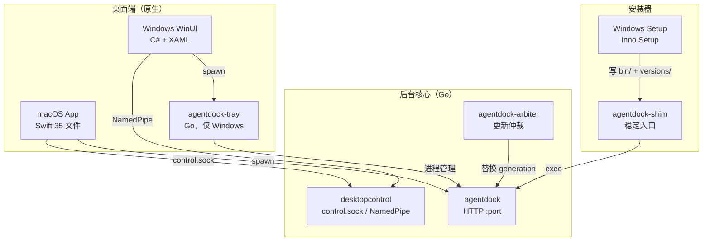
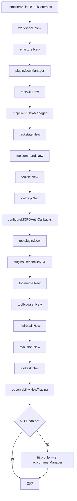

# 组件架构与通信

AgentDock 是**双栈**：Go 后台核心 + 平台原生桌面端。两者通过本地控制 socket / 命名管道通信，不共享代码、不共享进程。

## 顶层组件



## 可执行体

| 二进制 | 平台 | 职责 | 入口 |
|---|---|---|---|
| `agentdock` | 全平台 | 主服务：HTTP MCP / stdio / CLI 子命令 | `cmd/agentdock/main.go:27` |
| `agentdock-arbiter` | Windows / macOS | 更新事务仲裁；独立进程，不随主进程退出 | `cmd/agentdock-arbiter/main.go:19` |
| `agentdock-shim` | Windows | 稳定入口；指向当前 generation；崩溃恢复重放 | `cmd/agentdock-shim/main_windows.go:37` |
| `agentdock-tray` | Windows | 托盘宿主；拉 Core、读状态 | `cmd/agentdock-tray/main_windows.go:12` |
| `agentdock-wsl-helper` | Linux（WSL） | WSL 内文件互操作桥 | `cmd/agentdock-wsl-helper/main.go` |

`agentdock` 的 12 个 CLI 子命令见 [部署与运行架构](../01-架构总览/部署与运行架构.md)。这里关注**组件边界**。

## Go 侧：组合根

`app.Runtime` 是唯一组合根（`internal/app/runtime.go:39`）。

### 构造顺序



**任一步失败 → 按逆序 Close 已建组件**。这是为什么构造函数里有大量 `_ = xxx.Close()` 的重复 —— Go 没有 RAII。

**顺序不是随意的**：`plugin.NewManager` 早于 `toolplugin.New`，因为后者依赖前者的 `EnsureDataDir`；`ReconcileMCP` 必须早于其余工具，因为它决定 `dynamicMCP` 的初始 server 集合。

### 依赖注入形态

三种风格并存，各有理由：

| 风格 | 示例 | 为什么 |
|---|---|---|
| `func() config.Config` 闭包 | `toolcommand.New`、`evolution.New`、`tooltask.New` | 配置在运行期可变（`Runtime.cfg` 被 OAuth callback 修改），需要拿最新值 |
| 直接传值 | `toolbrowser.New(Config{...}, ...)` | 浏览器配置启动后不变 |
| 传接口 | `toolfile.New(ws, skills.ResolveResource, ...)` | 便于测试替身 |

`runtime.command` 的构造是三者混合的典型（`runtime.go:103-141`）：`SkillResolver` 闭包里区分 `managed` / `plugin` 两种来源，分别解析 `envstore.Scope`、`SkillDataDir`、`PluginDataDir`。

### `Close` 的顺序契约

`runtime.go:201-250`：

```go
r.lifecycleMu.Lock(); r.closing = true; commandCancel := r.commandCancel; r.lifecycleMu.Unlock()
r.command.BeginClose()      // 禁止新 reservation
r.command.WaitForStarts()   // 等已 reservation 的启动离开 cmd.Start 窗口
commandCancel()
r.acp.Close() → r.browser.Close() → r.command.Close() → r.dynamicMCP.Close()
r.plugins.ReleaseMCPLeases()
```

**`BeginClose`/`WaitForStarts` 不能持 `lifecycleMu`**（`runtime.go:212-214` 注释原文）：启动路径需要读生命周期状态，持锁等待会形成锁顺序死锁。这是陷阱 B1。

## 工具层：31 组 handler

`internal/tool/` 206 个文件，13 个子包：

| 子包 | 工具 | 服务对象 |
|---|---|---|
| `context` | `agentdock_context`、`workspace_context` | 上下文聚合 |
| `file` | `read_file`、`list_dir`、`search_text`、`file_edit` | `workspace.Workspace` |
| `command` | `exec_command`、`session_observe`、`session_act` | `toolcommand.Service` |
| `task` | `task_manage`、`workflow_template_manage` | `taskstate.Store` |
| `evolution` | `evolve` | `evolution.Service` |
| `acp` | `acp_session`、`acp_prompt`、`acp_interaction` | `acpruntime.Manager` |
| `skill` | `skill_manage` | `skill.Manager` |
| `plugin` | `plugin_manage` | `plugin.Manager` |
| `mcp` | `mcp_manage`、`mcp_tool_search`、`mcp_tool_inspect`、`mcp_tool_call` | `mcpclient.Manager` |
| `media` | `view_image`、`file_publish` | `publicartifacts.Store` |
| `recall` | 5 个 `recall_*` + `private_note_manage` | 本地索引 |
| `browser` | 3 个 `browser_*` | `chromedp` |
| `contract` | — | schema 构造与校验 |

工具契约的编译在 `internal/app/specs.go`：

| 类型/函数 | 位置 | 说明 |
|---|---|---|
| `ToolHandler` | `:12` | `func(ctx, runtime, args) (Result, error)` |
| `ToolContract` | `:14` | name + input/output schema |
| `ToolSpec` | `:23` | handler + contract + annotations |
| `ToolDefinition` | `:44` | 发给 MCP 客户端的形态 |
| `toolSpecByName` | `:123` | O(1) 查找 |
| `compileAvailableToolContracts` | `:128` | 启动期编译 + 可用性门 |

可用性门（`specs.go:152-154`）：`requiresNexus`（`NexusEndpoint != ""`）、`requiresBrowser`（`BrowserEnabled`）、`requiresACP`（`ACPEnabled`）。不满足的工具**直接从列表里消失**，而不是注册后报错。

## MCP 层：协议适配

`internal/mcp/server.go` 是 SDK 的薄封装：

| 方法 | 位置 | 用途 |
|---|---|---|
| `NewServer` | `:29` | 构造 + 注册全部工具 |
| `registerTool` | `:118` | 用**低层** `AddTool` |
| `callTool` | `:146` | 参数解码 → `Runtime.Call` → 信封 |
| `AgentDockContext` | `:60` | `/context` 的实现 |
| `HTTPHandler` | `:104` | StreamableHTTP |
| `ServeStdio` | `:108` | stdio 传输 |
| `ReadAppResource` | `:158`（`apps.go`） | MCP Apps 资源 |

**为什么用低层 `AddTool`**（`:118-144` 注释原文）：「AgentDock 的参数校验、权限错误和结构化输出都由 Runtime 统一处理，SDK 只负责协议、会话与传输语义。」

StreamableHTTP 选项（`:45-56`）：`Stateless: true`、`JSONResponse: true`、`MaxRequestBodyBytes: 1<<20`、`PropagateRequestCancellation: true`，以及条件性的 `DisableLocalhostProtection`（仅当配置了 OAuth 且强制认证）。

## 桌面端：macOS

`desktop/macos/AgentDockApp/Sources/` 35 个 Swift 文件，按职责分四组：

| 组 | 文件 |
|---|---|
| 生命周期 | `main.swift`、`AppDelegate.swift`、`BackgroundServiceLifecycle.swift`、`ServiceController.swift`、`MenuLoginAgentController.swift` |
| 窗口/UI | `NativeControlPanelWindowController.swift`、`TrayPopoverController.swift`、`UpdateProgressWindowController.swift`、`PermissionUIComponents.swift`、`ApplicationMenu.swift` |
| 功能 | `DesktopUpdate*.swift`、`InstallerRunner.swift`、`ManagedEnvironment.swift`、`TunnelTokenStore.swift`、`BrowserSupportController.swift`、`PublicEndpointChecker.swift`、`ServicePortValidation.swift` |
| 基础设施 | `AppPaths.swift`、`AppVersion.swift`、`Localization.swift`、`AppearancePreference.swift`、`DesktopPermissionChecker.swift`、`FileAccessPermissionChecker.swift`、`LegacyDesktopRuntimeMigration.swift` |

构建：`packaging/macos/build-app.sh`。

**通信**：Swift 侧没有链接 Go 代码，全部通过
1. 拉起 `agentdock` 子进程（`ServiceController`）
2. 读写 `control.sock`（`desktopcontrol.Call`）
3. 调 `agentdock update` 子进程（`InstallerRunner`）

## 桌面端：Windows

`desktop/windows/winui/` 是 WinUI 3 应用；`shared/` 位于 `desktop/windows/shared/`（与 `winui/`、`tray/` 平级，不是 `winui/` 子目录）：

| 层 | 文件（所有路径相对 `desktop/windows/`） |
|---|---|
| 页面 | `winui/HomePage`、`winui/ConnectionsPage`、`winui/CapabilitiesPage`、`winui/SettingsPage`、`winui/ActivityPage` |
| 壳 | `winui/App.xaml.cs`、`winui/MainWindow`、`winui/TrayIconHost.cs`、`winui/UiThemePreference.cs` |
| 服务 | `shared/Services/{RuntimeService,TaskAdminService,AcpAdapterResolver,ControlPanelDiagnostics,KillOnCloseJob}.cs` |
| 模型 | `shared/Models/RuntimeModels.cs` |
| 文案 | `shared/UiText.cs`、`shared/Resources/UiStrings{,.zh-CN}.resx` |

`KillOnCloseJob` 用 Job Object 保证托盘退出时子进程一起死 —— Windows 没有 macOS 的进程组语义。

## 本地控制通道

这是**唯一**的桌面端 → 核心管理通道。

### 协议

`desktopcontrol`（`control.go`）：

```go
type Request struct { ID, Method string; Params json.RawMessage }   // :17
type Handler func(ctx, Request) (any, error)                        // :31
func Serve(ctx, runtimeRoot, handler) error                         // :33
func Call(ctx, runtimeRoot, method, params, result) error           // :45
```

单条消息上限 1 MiB（`:11`）。一行一个 JSON 请求 → 一行一个 JSON 响应。

### 传输

| 平台 | 端点 | 权限 | 位置 |
|---|---|---|---|
| Unix | `<runtimeRoot>/control.sock` | 目录 0700，socket 0600 | `control_unix.go:18` |
| Windows | 命名管道，名含 SHA-256 | 保护性 DACL | `control_windows.go` |

Unix 侧：若已存在但不是 socket → 报错（防误删用户文件）；是 socket → 先删（上次崩溃残留）。

### 方法

`desktopruntime/control.go:26 DispatchControlRequest`：

| method | 返回 | 位置 |
|---|---|---|
| `ping` | `{"ready": true}` | `:37` |
| `service.status` | 服务状态 + `nexus_connected` | `:39-44` |
| `tunnel.status` | Tunnel 状态 | `:45` |
| 其它 | `不支持的本地控制方法: %s` | `:47` |

注释（`:20-21`）：「这里只暴露桌面日常管理能力，安装、卸载和提权仍由系统安装器负责。」

**这是安全设计**：socket 只能查询和启停，不能安装任意代码。

## 桌面端命令行子命令

`desktopruntime` 包同时提供 CLI 形态（`agentdock service/tunnel/config` 子命令的实现）：

| 文件 | 覆盖 |
|---|---|
| `service_command.go` | `service start/stop/restart/status/install/uninstall` |
| `tunnel_command.go` | `tunnel launch/status/start/stop/restart/regenerate/configure`（`:39 RunTunnelCommand`，分派 `:52`/`:56-68`/`:69-82`/`:83+`） |
| `config_command.go` | `config get/set` |
| `manifest.go` | 服务清单 |
| `default_runtime*.go` | `RuntimeRoot` 默认值 |

平台实现用 `_windows.go` / `_linux.go` / `_darwin.go` / `_other.go` 后缀区分，Linux 走 systemd，Windows 走 Task Scheduler 或 SCM，macOS 走 launchd。

## 通信拓扑总表

| 从 | 到 | 协议 | 用途 |
|---|---|---|---|
| MCP 客户端 | `agentdock` | StreamableHTTP `/mcp` 或 stdio | 工具调用 |
| MCP 客户端 | `agentdock` | HTTP `/context` | 上下文聚合 |
| 浏览器 | `agentdock` | HTTP `/artifacts/public/...` | 取产物 |
| 桌面端 | `agentdock` | `control.sock` / NamedPipe | 状态查询与启停 |
| 桌面端 | `agentdock` | HTTP `/internal/runtime/*` | 管理面板数据 |
| 桌面端 | `agentdock` | 子进程 CLI | 更新、安装 |
| `agentdock` | NexusDock | WebSocket | 远程桥接 |
| `agentdock` | 外部 MCP server | stdio / StreamableHTTP | 动态工具 |
| `agentdock` | ACP agent | JSON-RPC over stdio | 委派给 Claude/Codex 等 |
| `agentdock` | cloudflared | 子进程 | Tunnel |
| Arbiter | 文件系统 | `active.json` + `transaction.json` | 更新事务 |

## 相关文档

→ 详见 [服务层与IPC通信](./服务层与IPC通信.md)（每条通道的完整 API 清单）
→ 详见 [Store状态管理全景](./Store状态管理全景.md)（组合根装配的状态对象）
→ 详见 [系统分层架构](../01-架构总览/系统分层架构.md)（分层视角）
→ 详见 [部署与运行架构](../01-架构总览/部署与运行架构.md)（打包与启动）
