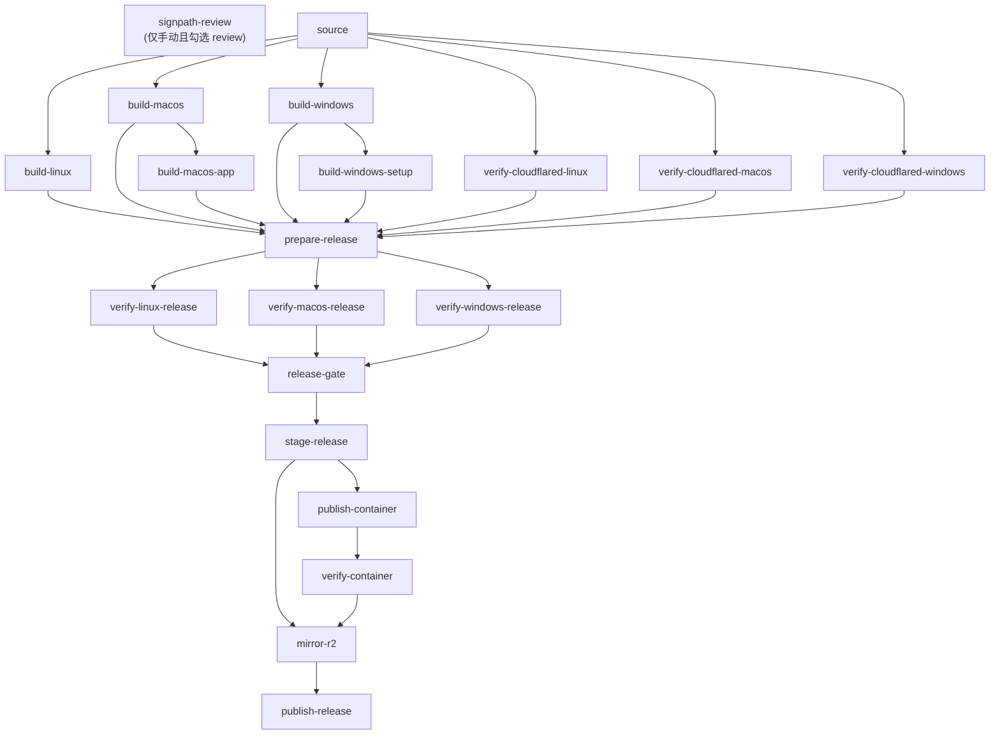

# Git 工作流与 CI

## 1. 提交规范

提交主题**接近** Conventional Commits，但**不是严格强制**：849 次提交中 723 次符合 `type(scope): 主题`，126 次不符（`Merge pull request #N ...`、`Merge remote-tracking branch ...`、早期无前缀主题如 `OAuth v4`）。

符合规范的 type 分布：

| type | 次数 |
|---|---|
| `fix` | 323 |
| `refactor` | 132 |
| `feat` | 125 |
| `chore` | 49 |
| `test` | 30 |
| `docs` | 23 |
| `merge` | 23 |
| `ci` | 7 |
| `release` | 4 |
| `style` | 3 |
| `task` | 2 |
| `perf` | 1 |
| `build` | 1 |

`release: 发布 v0.8.x` 与 `task: ...` 是非标准 type，历史遗留。新提交请用前 8 个。

格式：`type(scope): 主题`，scope 用**模块名小写**。实测高频 scope：`windows`(102)、`release`(63)、`macos`(58)、`mcp`(46)、`installer`(40)、`oauth`(24)、`desktop`(23)、`browser`(23)、`recall`(22)、`tools`(22)、`skill`(21)。

示例：

```
refactor(contract): 统一 JSON Schema 校验并保持兼容边界 (#248)
fix(windows): retry transient tray shim file locks during Setup (#236)
feat(nexus): 支持独立 WebSocket 入口与自动回退
```

**主题语言不强制**：中文、中英混合、纯英文都存在。约定是"主题说清做了什么"。

### 分支与合并

`main` 是唯一长期分支。CI 在 `pull_request → main` 触发；release 在 `push tags v*` 触发。仓内无 `develop`、无 release branch —— **rc 也打 tag**（`v1.0.0-rc.1` / `-rc.2` / `-rc.3`）。

合并方式混用：13 条 `Merge pull request #N` / `Merge remote-tracking branch` 是 Git 自动生成的合并提交（部分来自 fork：`siyuan-123`、`DeliciousBuding`），另有 23 条 `merge(scope): ...` 形式的手工合并提交。

## 2. 版本号来源

| 场景 | 来源 | 结果 |
|---|---|---|
| 源码构建 | `buildinfo.Version` 默认值 | `0.0.0-dev` |
| `make build` | `BUILD_VERSION ?= 0.0.0-dev` | 可覆盖 |
| Release CI | **Git Tag**（唯一权威） | 如 `v1.0.0-rc.3` |

`buildinfo`（`internal/buildinfo/buildinfo.go:11-15`）注释原文：「Version 的正式发行值由 Release CI 从不可变 Git Tag 注入。普通源码构建保持显式开发身份，避免把仓库里的字符串误当成发布版本。」

`ci_workflow_test.go:160-184` **禁止** release workflow 用 `go run ./tools/release verify-version` 或从源码 buildinfo 取版本 —— 版本只能从 tag 来。

版本规范化在 `internal/releaseversion/version.go:9 Normalize`：补 `v` 前缀 + `semver.IsValid` + **拒绝前导零**（`01.2.3` 非法）。

## 3. 六个 workflow

| 文件 | 触发 | 作用 |
|---|---|---|
| `ci.yml` | PR→main、manual | 三平台 Go 检查 + 浏览器集成 + 容器 |
| `release.yml` | `push tags v*`、manual | 20 job 链，产出全部发布物 |
| `windows-installer.yml` | PR→main、manual | Windows 安装器专项验证 |
| `codeql.yml` | push/PR→main、每周一 03:27 UTC | Go 安全扫描 |
| `cloudflared-component.yml` | manual | 验证并镜像 cloudflared 组件 |
| `r2-retention.yml` | manual | R2 发布保留策略执行 |

### `ci.yml`

`concurrency.cancel-in-progress: true`（PR 更新时取消旧运行）；`permissions: contents: read`（最小权限）。

| job | 超时 | 内容 |
|---|---|---|
| `go` | 20 min | 矩阵 ubuntu/macos/windows；Linux 额外 gofmt、`-count=20` ACP 竞态、`-race`、`vet`、`build`、`test-scripts`；macOS `test-scripts-macos`；Windows DPAPI + 未跟踪文件检查 |
| `browser-integration` | 15 min | xvfb + `-tags browser_integration -race` |
| `container` | 20 min | 先跑 `git diff` 路径过滤，命中 `Dockerfile`/`.dockerignore`/`docker-compose.yml`/`core-skills`/`cmd`/`internal`/`packaging/docker`/`go.mod` 等才执行 `test-docker-images.sh` |

`container` job 的路径过滤是**性能设计**：只改文档或脚本时不必付一次镜像构建。注意过滤范围**包含 `cmd`、`internal`、`go.mod`** —— 大多数代码改动都会命中，真正的豁免面很窄。

### `release.yml`

20 个 job，`concurrency: release-publication` + **`cancel-in-progress: false`** —— 发布不允许被打断。



两条容易看错的边：

- **`R2 → publish-release`**：`publish-release` 的 `needs` 是 `[source, stage-release, mirror-r2]`，R2 镜像没完成就不发布。
- **`VC → R2`**：`mirror-r2` 需要 `verify-container` 成功，容器镜像验证失败会挡住整个发布。

**`release-gate`**（`:1222-1240`）用 `if: always()` + 逐个 `test "$result" = success` —— 即使上游 job 被跳过也必须显式失败，不允许"没有状态就算过"。

**`prepare-release` 之前都是构建，之后才是验证**：先把所有产物 stage 好，再逐平台 verify，最后统一 gate。这样任何单平台失败都不会发布半套产物。

### 三个硬性发布约束

1. **`v1.0.0` 必须设 `LEGACY_GITHUB_LATEST_TAG`**（`:1547-1549`）。不设则 `exit 1`。原因：v0.9.x 老客户端把 GitHub `releases/latest` 当更新 API，必须保留一个"兼容桥"指向老版本，否则老客户端会直接跳到 v1.0.0 跳过迁移逻辑（陷阱 D1）。
2. **兼容桥 tag 必须 ≠ 本次 tag**（`:1551-1553`），且必须是 `draft=false`、`prerelease=false` 的已发布版本（`:1556-1559`）。
3. **staged `install.ps1` 必须与 Git blob 一致**（`ci_workflow_test.go:186-200`）：用 `git hash-object --no-filters` 比较，**不能**用 `Get-FileHash` —— Windows checkout 可能改写行尾，会误判。

### `windows-installer.yml`

三 job：`changes`（路径过滤）→ `validate`（PowerShell 5.1 实际跑安装器）→ `gate`（`always()`，`needs: [changes, validate]`）。

`ci_workflow_test.go:71-130` 锁死了一长串断言，包括：
- 必须用 checked-out 的 `install.ps1`，**禁止**从 `raw.githubusercontent.com` 重新拉
- `cloudflared` 必须 pin 版本，**禁止** `releases/latest`
- Setup 构建**不得**内嵌 cloudflared payload
- 测试版本必须通过 `-ldflags -X` 注入，**禁止**改写或解析 `buildinfo.go`
- 版本从 `tools/release` 推导，不是硬编码

这是本仓最密集的策略测试：任何"简化"都会被打回。

### `codeql.yml`

Go 单语言，`security-events: write`。每周一 03:27 UTC 定时 + main 的 push/PR。

### `r2-retention.yml`

单个 job `reconcile`，两步：`Validate inputs and build retention plan` → `Apply retention plan`。输入 `expected_current_tag`（必填）+ `apply`（默认 `false`，只出计划不删）。

三重前置校验，任一失败即退出：必填变量非空、`R2_PUBLIC_BASE_URL` 必须等于 `https://download.nexusdock.co`、`latest.json` 里的 tag 必须等于传入的 `expected_current_tag`。这是**防误删**设计 —— 拿错 tag 运行不会删掉别人的版本。

注意它和 `release.yml` **共用 `concurrency.group: release-publication`**，且同样 `cancel-in-progress: false`：保留策略永远不会和发布并发执行。

### `cloudflared-component.yml`

手动触发，输入 `version`（必须在 `internal/component/catalog-v1.json` 里已 pin）+ `publish_catalog`（默认 `true`）。

四个 job：`verify-macos`（amd64+arm64）、`verify-linux`（amd64+arm64）、`verify-windows` → `publish-r2`（`needs` 三者全部成功）。

`publish-r2` 先 `go test ./internal/component ./tools/release` 复验，再上传不可变镜像；`concurrency.group: cloudflared-component-<version>` 保证同版本不会并发发布。版本号来自**输入**而不是上游 latest —— 与 `ci_workflow_test.go` 禁止 `cloudflared/releases/latest` 的策略一致。

## 4. 本地 → CI 的落差

| 本地 | CI | 差异 |
|---|---|---|
| `make fmt-check` 查 `./cmd ./internal ./desktop` | `git ls-files '*.go'` 全量 | CI 覆盖 `tools/`、`scripts/test/testdata/` |
| `make check` 无 `race` | Linux 跑 `-race ./...` | 并发改动必须单跑 |
| 无 `-count=1` | 强制 | 本地可能命中缓存导致"假绿" |
| 无 Windows 洁净检查 | 有 | 本地测试留文件不会被发现 |

**结论**：本地绿 ≠ CI 绿。改并发跑 `make race`；改脚本跑 `make test-scripts`；改 CI/YAML 跑 `go test ./scripts/test`。

## 5. 提交前清单

```bash
make fmt
make check          # fmt-check + test + test-scripts + vet + build
make race           # 并发相关改动必跑
go test ./scripts/test -count=1   # 改了 workflow / 脚本清单 / 日志策略
```

涉及 ACP steering 的改动额外跑 §[测试策略](./测试策略.md#3-竞态测试) 里的 `-count=20`。

## 相关文档

→ 详见 [编码规范](./编码规范.md)
→ 详见 [测试策略](./测试策略.md)
→ 详见 [部署与运行架构](../01-架构总览/部署与运行架构.md)（Dockerfile / compose / 打包）
→ 详见 [版本历史](../06-迭代与变更/版本历史.md)（rc 节点与提交分组）
