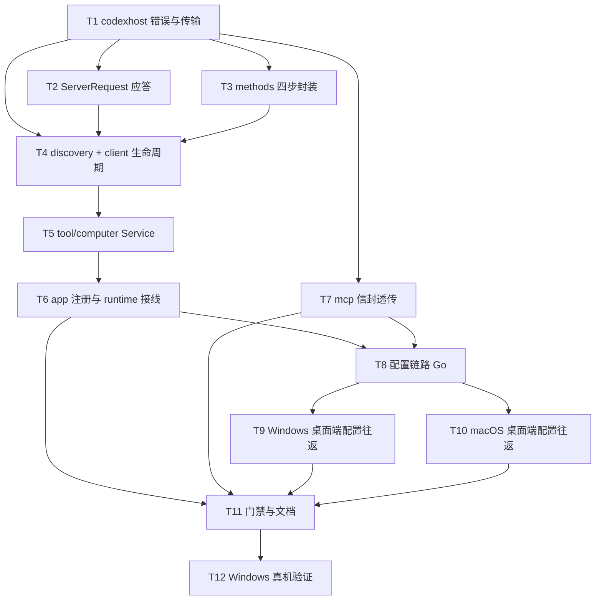

# AgentDock Computer Use 规划任务文档 v1.0.0

> 版本：1.0.0 · 上游：`docs/v1.0.0/设计文档.md`、`docs/v1.0.0/契约规范.md`
> 路线：**借本机 Codex 作宿主**——`codex app-server` 子进程 + `mcpServerStatus/list` 发现 + `mcpServer/tool/call` 代理。不自研执行器。
> 分组：BE-Core（`internal/codexhost`、`internal/tool/computer`、接线、配置）、BE-Desk（Windows WinUI + macOS Swift 配置往返）、QA（门禁与真机验证）
> 状态：**Wave 1（T1–T11）已全部完成并实测**，Wave 2（T12 Windows 真机验证）待执行。
> 验证缺口：本机 Linux 无 `swiftc`/`xcrun`/`dotnet`，且 Linux 版 Codex 不含 `computer-use` 插件，真实插件行为只能在 Windows 真机复验。

## 1. 任务依赖图



> 依赖说明：T1 是全部任务的根（错误类型与传输被所有层引用）；T2/T3 与 T4 有真实依赖（`client` 组装时同时需要应答表与方法封装）；T11 是汇总门禁，必须等所有实现与文档落地后才跑。

## 2. 需求覆盖矩阵

| 设计文档章节 | 覆盖任务 |
|---|---|
| §1.1 目标与边界 | T5、T11 |
| §1.2 进程与传输拓扑 | T1、T4、T7 |
| §1.3 新增文件清单 | T1–T5 全量 |
| §1.4 修改文件清单 | T6、T7、T8、T9、T10 |
| §1.5 复用关系 | T1、T3、T5、T6、T8、T9、T10 |
| §1.6 工具↔端点映射 | T3、T5 |
| §2.1 懒启动时序 | T4、T5 |
| §2.2 透传时序 | T5、T7 |
| §2.3 发现流程 | T3、T5 |
| §2.4 降级路径 | T5、T11、T12 |
| §3 数据库变更（不涉及） | —（无任务） |
| §4.1 错误传播三层 | T1、T5 |
| §4.2 返回值形态 | T5 |
| §4.3 兜底清单 | T1、T2、T4、T5、T7 |
| §5.2 风险 R1–R10 | T12（R1/R2/R5）、T4（R6/R7/R8）、T1（R9）、T5（R10） |
| §6 Gate 自查 | T11、T12 |

## 3. 任务清单

### 3.1 Wave 1 · BE-Core（宿主客户端）

- [x] **Task 1: codexhost 错误体系与 NDJSON 传输**（P0 · 估时 120min · 依赖：无 · **已完成**）
  - **涉及文件**：`internal/codexhost/errors.go`、`transport.go`、`transport_test.go`
  - **需求覆盖**：设计 §1.2、§4.1、§4.3；契约 §1.1、§3.1
  - **实现要点**：
    - 12 个 `CODEXHOST_*` 常量（`errors.go:11-24`），`Error` 带 `Retryable`/`Details`/`Cause`，`ErrorCode(err)` 供上层映射。
    - `maxMessageBytes = 32 << 20`（`transport.go:17`）同时约束 scanner buffer（`:123`）与写侧（`:214-215`）；入站超长由 `bufio.ErrTooLong` 映射为同一错误码（`:148-157`）。
    - `call`（`:66`）按 `id` 注册 pending；`readLoop`（`:121`）分派响应/通知/ServerRequest；`writeMu` 串行写（`:40`）；`handleResponse` `:189`、`writeMessage` `:209`。
    - `finish`（`:247`）关闭全部 pending 并以 `CodeConnectionClosed` 唤醒等待者。
  - **验证**：`go test ./internal/codexhost/ -run 'TestCall|TestServerRequest|TestOversize|TestWriteRejects' -v` PASS；`TestWriteRejectsOversized`（`transport_test.go:273-300`）断言出站超限即错且一个字节都不写，`TestOversizeInboundMessageIsReportedAsTooLarge`（`transport_test.go:232-265`）断言入站超长落同一错误码且不可重试。

- [x] **Task 2: ServerRequest 全量自动拒绝**（P0 · 估时 90min · 依赖：T1 · **已完成**）
  - **涉及文件**：`internal/codexhost/server_requests.go`、`server_requests_test.go`、`testdata/schema/*.json`（8 个）
  - **需求覆盖**：设计 §4.3；契约 §5.2
  - **实现要点**：
    - 10 个方法常量（`:12-26`），`answerServerRequest`（`:37`）逐个给出形状正确的拒绝应答。
    - `applyPatchApproval`/`execCommandApproval` 用**对象形态** `{"decision":{"denied":{"rejection":...}}}`，其余用字符串 `decline`。
    - 凭据类（`account/chatgptAuthTokens/refresh`、`attestation/generate`）回 `-32050`；未知方法回 `-32601`。
    - handler 内 `recover()` → `-32603`（`transport.go:165-186`），单次 panic 不终止读循环。
  - **验证**：`server_requests_test.go` 用 `jsonschema-go` 对照 `testdata/schema/*.json` 校验每个应答合法性，全部 PASS。

- [x] **Task 3: methods 四步封装**（P0 · 估时 150min · 依赖：T1 · **已完成**）
  - **涉及文件**：`internal/codexhost/methods.go`
  - **需求覆盖**：设计 §1.6、§2.1、§2.3；契约 §3.3.3–§3.3.6
  - **实现要点**：
    - `Initialize`（`:21`）解析 `userAgent/codexHome/platformFamily/platformOs`，缺失即 `CodexHostInvalidResponse`，随后必发 `initialized` 通知（`:44`）。
    - `StartThread`（`:71`）只解 `thread.id`；`EnsureThread`（`client.go:151`）幂等复用。
    - `ListMCPServers`（`:139`）默认 `detail="toolsAndAuthOnly"`（`:144`），按 `nextCursor` 翻页，`mcpStatusMaxPages = 50`（`:176`）封顶。
    - `CallMCPTool`（`:239`）把 `server`/`threadId`/`tool`/`arguments` 装入 `mcpServer/tool/call`；结果三选一（content / isError / structuredContent），全缺即 `CodexHostInvalidResponse`。
    - `Text()`（`:287`）只拼接 text 块；`Images()`（`:309`）挑出 image 块，`ImageContent`（`:328`）带 mimeType。
  - **验证**：`AGENTDOCK_TEST_CODEX_APP_SERVER=1` 冒烟 `TestRealAppServerSmoke`（`client_smoke_test.go:48`/`:75`）真实走 `ListMCPServers` 与 `CallMCPTool`，PASS 1.7–2.4s。

- [x] **Task 4: discovery 与 client 生命周期**（P0 · 估时 150min · 依赖：T1、T2、T3 · **已完成**）
  - **涉及文件**：`internal/codexhost/discovery.go`、`client.go`、`child_unix.go`、`child_windows.go`、`client_smoke_test.go`
  - **需求覆盖**：设计 §1.2、§2.1、§5.2 R6/R7/R8；契约 §3.1、§5.3
  - **实现要点**：
    - `DiscoverCodex`（`:27`）：配置路径 → `PATH` → 报 `CODEXHOST_CODEX_NOT_FOUND`，`Source` 记录来源。
    - `resolveCodexHome`（`:50`）：配置 → `CODEX_HOME` → `$HOME/.codex`。
    - `Start`（`client.go:72`）：`envstore.Merge(MinimalSystemEnv(), overlay)`（`:95`）**必定**覆盖 `CODEX_HOME`（`:92-94`）→ `exec.Command(path, "app-server")`（`:99`）→ `configureChild`（`:117`）→ `processcontrol.Attach`（`:127`）→ `newTransport`（`:138`）→ `Initialize`。
    - 超时：`initializeTimeout = 30s`（`:23`）、`threadTimeout = 30s`（`:25`）；`stderrTailBytes = 64 << 10`（`:27`）环形尾，`wrapError`（`:233`）附到 `details.stderr`。
    - `redactEnvironmentValues`（`:258`）防止环境变量泄漏进日志。
    - Windows `configureChild` 只设 `HideWindow`（`child_windows.go:14-18`），注释明确禁止加 `CREATE_NO_WINDOW`。
  - **验证**：
    ```bash
    AGENTDOCK_TEST_CODEX_APP_SERVER=1 CODEX_HOME=/home/dev/.codex \
      CGO_ENABLED=0 go test ./internal/codexhost/ -run TestRealAppServerSmoke -v
    ```
    实测 PASS（1.7–2.4s，多次运行区间）：`userAgent="agentdock/0.162.0 (Debian 12.0.0; x86_64) unknown (agentdock; 0.0.0-dev)"`，`thread 01a1618f-fe96-70f1-a14a-dcfd164fd644`，`server codex_apps auth=bearerToken runtime=starting tools=91`。

### 3.2 Wave 1 · BE-Core（工具层）

- [x] **Task 5: tool/computer Service**（P0 · 估时 180min · 依赖：T4 · **已完成**）
  - **涉及文件**：`internal/tool/computer/contract.go`、`errors.go`、`service.go`、`service_test.go`
  - **需求覆盖**：设计 §2.2、§2.3、§4.1、§4.2、§5.2 R10；契约 §1.2、§2.3、§2.4
  - **实现要点**：
    - 只有两个工具：`computer_status`（只读）与 `computer_call`（变更、`openWorldHint=true`）；`arguments` 用 `OpenObject` 承接任意原生参数。
    - 4 个内部错误码（`errors.go:14-19`）+ `hostError`（`:28`）保留 `codex_code`/`codex_details`/`retryable`。
    - `hostClient` 接口（`service.go:28-34`）让单测注入 `fakeHost`，`Service.start` 字段是函数，测试可替换。
    - `New`（`:53`）补默认 server 名；`HandleStatus`（`:73`）→ `ListMCPServers(detail=toolsAndAuthOnly)` → 组装 `servers`/`computer_use`；`HandleCall`（`:172`）→ 拼参数 → `CallMCPTool` → `toolResult`。
    - `acquire`（`:253`）与 `connect`（`:263`）持 `s.mu` 覆盖整段启动；启动失败即 `client.Close()` 回收。
    - `Close`（`:301`）幂等，从未启动时直接返回。
    - 除 `tool` 缺失与 `arguments` 非对象（`argumentsArg` `:203-213`）外，所有失败都 `(Result, nil)`，错误进 `error` 字段（`:172-197`）；经 `tools/call` 时非法参数会先被 `Runtime.Call` 的 schema 校验以 `INVALID_ARGUMENT` 拦下（`runtime.go:324-340`），handler 校验是第二道防线；连接终态错误由 `resetIfDead`（`:231-248`，含身份检查 `:238`）丢弃缓存 client，下次调用重起子进程。
  - **验证**：`go test ./internal/tool/computer/ -v` 15 个测试 PASS：content 原样（含 image block）、插件 `is_error` 不设 `error`、host 失败带 `codex_code`、缺 `tool` 参数、status 检出、status 未装、`server` 过滤不影响 `available`、连接终态后重起宿主、插件级失败不重启宿主、宿主不可达时 `computer_use` 形状不变、`arguments` 非对象直接报错不调宿主、陈旧 client 的迟到失败不误杀新 client、`codex_home` 回显已解析值、未握手时省略 `codex_home`、`Close` 只调一次。

- [x] **Task 6: app 注册与 runtime 接线**（P0 · 估时 60min · 依赖：T5 · **已完成**）
  - **涉及文件**：`internal/app/specs_computer.go`（新增）、`specs_registry.go`、`specs_contract.go`、`specs.go`、`runtime.go`、`output_contract_coverage_test.go`
  - **需求覆盖**：设计 §1.4、§1.5；契约 §2.1、§2.2
  - **实现要点**：
    - `computerToolSpecs()`（`specs_computer.go:9-18`）两个 `ToolSpec`，`Availability: requiresComputer`。
    - `specs_registry.go:16` 插在 `pluginToolSpecs` 与 `dynamicMCPToolSpecs` 之间。
    - `specs_contract.go:98-100` `computerToolContract` = `staticToolContract(name, toolcomputer.InputSchema, toolcomputer.OutputSchema)`。
    - `specs.go:155-157` `requiresComputer` 只读 `cfg.CodexHostEnabled`，不做探测。
    - `runtime.go:51` 字段；`:163-170` 惰性构造（在 `runtime.recall` 之前）；`:244-250` `Close` 中先关 computer 再关 command。
    - `output_contract_coverage_test.go:51-52` 两条 `success` 变体（不能用 `IntegrationOnly`，白名单只放行 `browser_` 前缀）。
  - **验证**：`CGO_ENABLED=0 go test ./internal/app/ -run 'TestOutputContractCoverageMatchesPublicTools|TestComputerToolsAreFeatureGated' -v` PASS。

### 3.3 Wave 1 · BE-Core（MCP 信封）

- [x] **Task 7: computer_call 信封透传**（P0 · 估时 45min · 依赖：T1 · **已完成**）
  - **涉及文件**：`internal/mcp/server.go`
  - **需求覆盖**：设计 §2.2；契约 §2.5
  - **实现要点**：
    - `toolEnvelope`（`:274`）在 `mcp_tool_call` 分支（`:301-303`）之后加 `if name == "computer_call"`（`:304-305`）。
    - `computerToolEnvelope`（`:316-331`），分支 `:307-309`：取 `payload["content"]`，空则回落单 text block；`isError = payload["is_error"] || !payload["host_ok"]`；`structuredContent` 原样。
    - 与 `dynamicMCPToolEnvelope`（`:330`）分离，理由：`computer_call` 的 payload 是本地结构化结果，不是远端 `result` 包装。
  - **验证**：`go test ./internal/mcp/ -run 'TestToolEnvelope|TestToolOutputSchemas' -v` PASS（`TestToolEnvelopePassesComputerCallContentThrough`、`TestToolEnvelopeMarksComputerCallErrorWithoutHostOK`、`TestToolEnvelopeMarksComputerStatusFailureWithoutHostOK`、`TestToolEnvelopePassesThroughDynamicMCPContent`、`TestToolEnvelopeMCPImageStripsInternalBase64FromStructuredContent`）；`TestToolOutputSchemasDoNotExposeGenericOK`（`registry_test.go:52`）PASS，确认顶层无 `ok`。

### 3.4 Wave 1 · BE-Core（配置链路）

- [x] **Task 8: 配置链路 Go 侧**（P0 · 估时 90min · 依赖：T6、T7 · **已完成**）
  - **涉及文件**：`internal/config/config.go`、`cmd/agentdock/server.go`、`internal/desktopruntime/config_command.go`、`service_environment_windows.go`、`config_windows.go`
  - **需求覆盖**：设计 §1.4；契约 §2.1
  - **实现要点**：
    - 4 个字段（`config.go:90-99`）；env `AGENTDOCK_CODEX_HOST_ENABLED`（`:158`，默认 false）、`AGENTDOCK_COMPUTER_USE_SERVER`（`:162`，默认 `computer-use`）；赋值 `:213-216`；`Normalize` 绝对路径校验 `:292-305`。
    - CLI flags `--codex-host-enabled`/`--codex-executable-path`/`--codex-home`/`--computer-use-server`（`cmd/agentdock/server.go:65-68`）。
    - `ConfigUpdateRequest` 4 字段（`config_command.go:28-31`）+ 校验（`:156-166`：绝对路径 + 普通文件）→ `config_windows.go:137-140` 映射。
    - `managedCoreEnvironment`（`service_environment_windows.go:106`/`:118-125`）：`AGENTDOCK_CODEX_HOST_ENABLED` 无条件写，另三个非空才写；`controlPanelSettings` 4 个 `omitempty` 字段（`:62-65`）。
  - **验证**：`go build ./...`；`go test ./internal/config/ ./internal/desktopruntime/ -count=1` PASS；`agentdock --help` 可见 4 个 flag。

### 3.5 Wave 1 · BE-Desk（桌面端配置往返）

- [x] **Task 9: Windows WinUI 配置往返**（P1 · 估时 60min · 依赖：T8 · **已完成**）
  - **涉及文件**：`desktop/windows/shared/Models/RuntimeModels.cs`、`shared/Services/RuntimeService.cs`、`winui/CapabilitiesPage.xaml`、`winui/CapabilitiesPage.xaml.cs`、`shared/Resources/UiStrings.resx`、`UiStrings.zh-CN.resx`
  - **需求覆盖**：设计 §1.4；契约 §7
  - **实现要点**：`RuntimeModels.cs:107-117` 的 4 个新增属性；`RuntimeService.cs:738-741` 的 4 个 `--` 参数；`CapabilitiesPage.xaml` 在 McpApps 卡片前插入 Computer Use 卡片（开关 + 3 个输入框）；`ApplySettings` 回填并按路径有无切换详情文案；resx 各 3 条字符串。
  - **验证**：❌ **未验证**——本机无 `dotnet`。需 Windows 机器 `dotnet build desktop/windows`。

- [x] **Task 10: macOS 配置往返**（P1 · 估时 75min · 依赖：T8 · **已完成**）
  - **涉及文件**：`desktop/macos/AgentDockApp/Sources/AppPaths.swift`、`ServiceConfigurationController.swift`、`NativeControlPanelWindowController.swift`、`Resources/{en,zh-Hans}.lproj/Localizable.strings`
  - **需求覆盖**：设计 §1.4、§1.5；契约 §7
  - **实现要点**：`editableKeys` 加 4 键（**必须**，否则 `ManagedEnvironment.isSubset` 守卫抛错）；`EditableServiceSettings` 4 字段 + `normalizeAbsolutePath` + 文件存在性校验；`replacements` 4 条；`NativeControlPanelWindowController` 4 个 `@State` + SettingsCard + 3 处构造点全部传参。
  - **验证**：❌ **未验证**——本机无 `swiftc`/`xcrun`。需 macOS 机器 `swift build`。

### 3.6 Wave 1 · QA

- [x] **Task 11: 门禁与文档**（P0 · 估时 120min · 依赖：T6–T10 · **已完成**）
  - **涉及文件**：`docs/v1.0.0/契约规范.md`、`设计文档.md`、`规划任务文档.md`、`adversarial-review.md`、`评审报告.md`、`tests/contract/*`
  - **需求覆盖**：设计 §6；契约 §8、§9
  - **验证命令与实测结果**：
    | 门禁 | 命令 | 结果 |
    |---|---|---|
    | 全量测试 | `CGO_ENABLED=0 go test ./... -count=1` | 60 包 ok，零 FAIL |
    | 契约覆盖 | `go test ./internal/app/ -run TestOutputContractCoverageMatchesPublicTools` | PASS |
    | 契约 extractor | `extract.py --sdd docs/v1.0.0/契约规范.md` | `endpoints=6 covered=6 ratio=1.0` |
    | 构建 | `CGO_ENABLED=0 go build ./internal/... ./cmd/...` | OK |
    | Windows 交叉 | `GOOS=windows GOARCH=amd64 CGO_ENABLED=0 go build ./...` | OK |
    | Windows arm64 交叉 | `GOOS=windows GOARCH=arm64 CGO_ENABLED=0 go build ./...` | OK |
    | macOS 交叉 | `GOOS=darwin GOARCH=arm64 CGO_ENABLED=0 go build ./internal/... ./cmd/...` | OK |
    | macOS amd64 交叉 | `GOOS=darwin GOARCH=amd64 CGO_ENABLED=0 go build ./internal/... ./cmd/...` | OK |
    | 格式 | `gofmt -l <全部改动包>` | 无输出 |
    | 真实宿主冒烟 | `AGENTDOCK_TEST_CODEX_APP_SERVER=1 go test ./internal/codexhost/ -run TestRealAppServerSmoke` | PASS 1.7–2.4s（三轮实测：1.89s / 2.36s / 1.71s） |

### 3.7 Wave 2 · 真机验证

- [ ] **Task 12: Windows 真机验证清单**（P0 · 估时 180min · 依赖：T11 · **待执行**）
  - **前置**：Windows 机器已装 Codex 桌面端（含 `openai-bundled` marketplace 与 `computer-use` 插件）、已构建 AgentDock。
  - **步骤与判据**：
    1. `codex plugin marketplace list` → 应见 `openai-bundled`。
    2. `codex plugin list` → 应见 `computer-use@openai-bundled`。
    3. 未装则 `codex plugin add computer-use@openai-bundled`，记录是否成功。
    4. 启 `agentdock --codex-host-enabled --browser-enabled=false`，调 `computer_status`：`computer_use.available=true` 且 `tools` 恰为 11 个（`click`/`drag`/`get_app_state`/`list_apps`/`perform_secondary_action`/`press_key`/`query`/`scroll`/`select_text`/`set_value`/`type_text`）。
    5. `computer_call{tool:"list_apps"}` → 文本行格式为 `App Name — bundle.id [running, ...]`。
    6. `computer_call{tool:"get_app_state",arguments:{"app":"<某应用>"}}` → 文本以 `App=<bundle id> (pid N)` 起头、末行 `The focused UI element is N <role>.`；同时收到 `type:"image"` 块。**重点：是否复现 macOS 的 `Apple event error -10000: Sender process is not authenticated`**。
    7. 逐项验证 `include_ax`/`include_screenshot`/`text_limit`/`max_tree_nodes`/`max_tree_depth`/`window_placement` 实际生效（分别改参数观察输出差异）。
    8. 无效 app 名 → 期望 content 文本 `appNotFound("...")`，且 `host_ok=true`、`is_error=true`。
    9. 终端类 App / ChatGPT 自身 → 期望 `Computer Use is not allowed to use the app '<bundle id>' for safety reasons.`。
    10. 配 `[computer_use.windows] always_allowed_app_ids = ["mspaint.exe"]` 后重试画笔操作，确认授权被识别。
    11. `computer_call{tool:"不存在的工具"}` → `host_ok=false`、`error.code=COMPUTER_CALL_FAILED`、`details.codex_code=CODEXHOST_REMOTE_ERROR`。
    12. **R1 判据**：若第 6 步复现 `-10000`，宿主路线不成立，立即停止并升级为「回落自研执行器」决策，不得静默继续。
  - **附加判据（`codex_home` 比对）**：第 4 步的 `computer_status.codex_home` 必须与「能看到 `computer-use` 插件」的那个 shell 里的 `$env:CODEX_HOME` 一致（未设则为 `$env:USERPROFILE\.codex`）。不一致说明 AgentDock 拉起的宿主读的是另一个 home，此时插件「看起来缺失」是假象，先修 `--codex-home` 再复验，不得直接判 R1。
  - **产出**：每步一条「命令/调用 → 实际输出 → PASS/FAIL」记录，附 `codex --version`、AgentDock 版本、Windows 版本。文档缺口：本仓库 `tests/contract/` 是 schema 级契约测试，不含真机断言。

## 4. 估时汇总

| 分组 | 任务 | 合计估时 | 状态 |
|---|---|---|---|
| BE-Core 宿主客户端 | T1–T4 | 510min | ✅ 完成 |
| BE-Core 工具层 | T5–T6 | 240min | ✅ 完成 |
| BE-Core 信封与配置 | T7–T8 | 135min | ✅ 完成 |
| BE-Desk 桌面端 | T9–T10 | 135min | ✅ 完成（未编译验证） |
| QA 门禁与文档 | T11 | 120min | ✅ 完成 |
| Wave 2 真机 | T12 | 180min | ⬜ 待执行 |
| **合计** | 12 项 | **1320min ≈ 22h** | 11/12 完成 |

## 5. 优先级与并行编排

| 优先级 | 任务 | 说明 |
|---|---|---|
| P0 | T1–T8、T11、T12 | 缺任一则链路或门禁不通 |
| P1 | T9、T10 | 只影响桌面端的配置可达性，不影响 Core 功能与构建 |

回放用并行切片（若需重跑）：

| Worker | 任务 |
|---|---|
| W1 | T1 → T2/T3 → T4 |
| W2 | T5 → T6 |
| W3 | T7、T8（T8 依赖 T6/T7 的常量，可先写结构后补值） |
| W4 | T9、T10（互不依赖） |
| W5 | T11（必须最后） |

串行约束只有两条：T4 必须等 T1–T3；T11 必须等全部实现落地。
