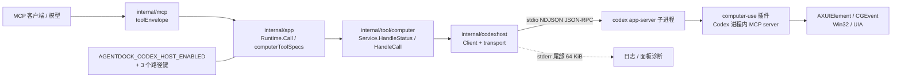
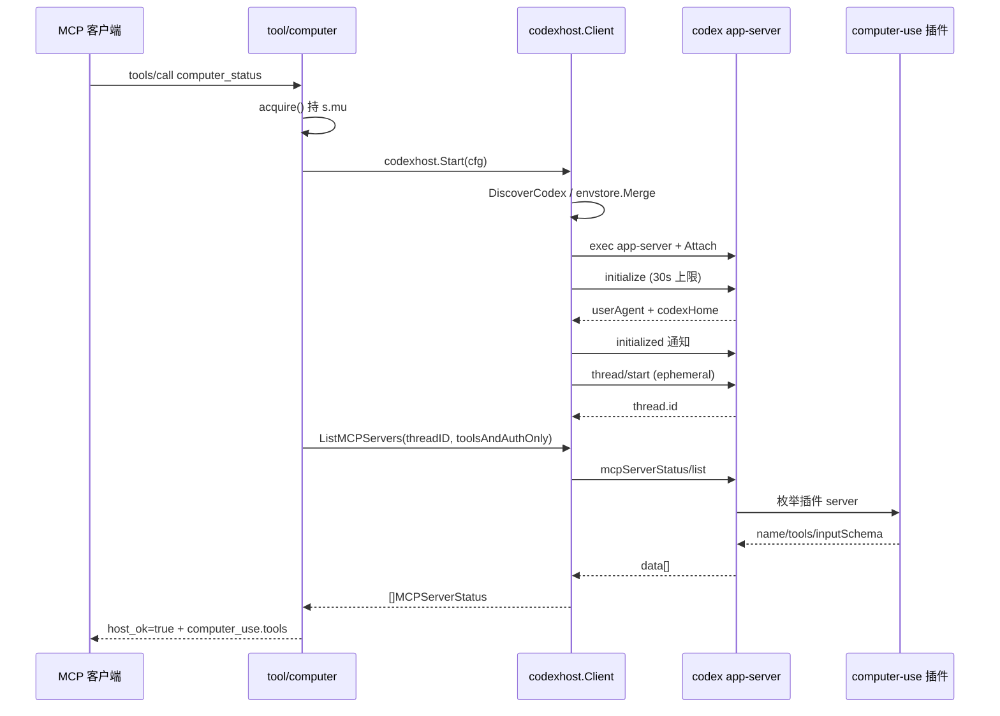
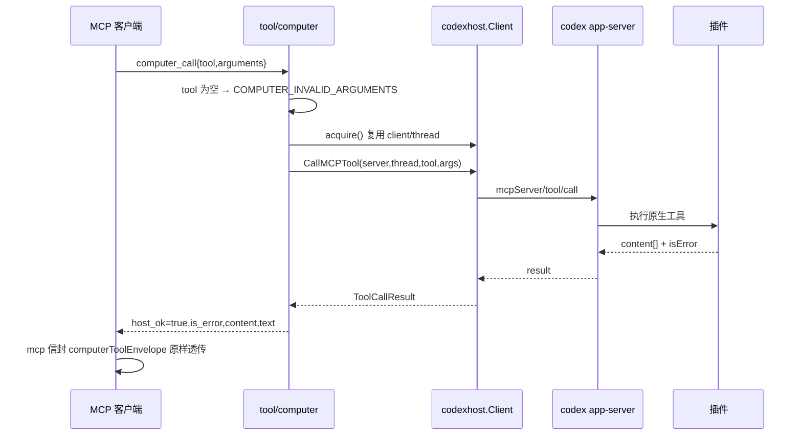
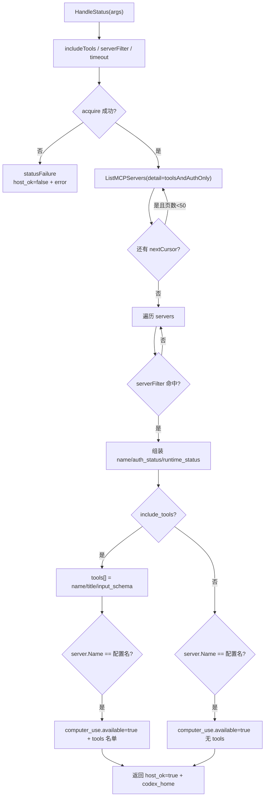
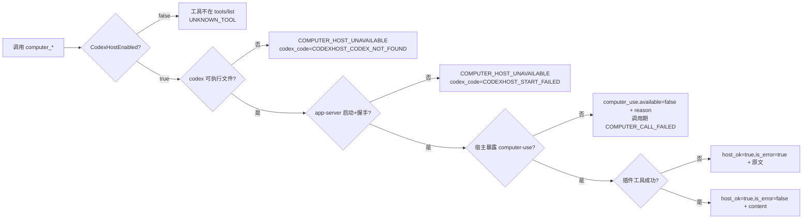

# AgentDock Computer Use 设计文档 v1.0.0

> 版本：1.0.0 · 状态：Phase 3 设计（对应 Phase 2 契约 `docs/v1.0.0/契约规范.md`）· 适用平台：由 Codex 桌面端提供插件的平台（macOS / Windows）
> 关联：MCP 工具层（`internal/app`）↔ 工具实现（`internal/tool/computer`）↔ 宿主客户端（`internal/codexhost`）↔ `codex app-server` 子进程 ↔ `computer-use` 插件（在 Codex 内）↔ OS
> 验证缺口：本机（Linux，`go1.26.5 linux/amd64`）无 `swiftc`／`xcrun`／`dotnet`，Swift 与 C# 改动无法编译验证；Linux 版 Codex **不含** `computer-use` 插件（`codex plugin list` 7817 行中零命中），真实插件行为只能在 Windows 真机复验。文中所有插件行为断言均以逆向样本为据，标注证据出处。

## 1. 架构设计

### 1.1 设计目标与边界

用**代理**而非**自研**获得桌面操作能力：AgentDock 拉起本机 `codex app-server` 子进程，通过 stdio NDJSON JSON-RPC 复用 Codex 内建的 `computer-use` 插件，把它的 11 个工具包装成两个 AgentDock MCP 工具——`computer_status`（发现）与 `computer_call`（透传）。

三条不可破的边界：

1. **不自研执行器**。macOS 上无障碍自动化客户端必须由 OpenAI 签名（Team ID `2DC432GLL2`）的父进程启动；非签名父进程经管道拉起 `SkyComputerUseClient` 会被系统 `SIGKILL`（Code Signature Invalid）。Windows 侧理论可写 `user32` syscall，但会造出第二套寻址模型与第二套错误语义，契约无法统一。
2. **不重定义工具 schema**。11 个原生工具的 `inputSchema` 由宿主经 `mcpServerStatus/list` 下发，是唯一事实源。AgentDock 只提供 `arguments: OpenObject` 开口，不镜像、不改名、不补默认值（契约 §0.3）。
3. **不参与授权判定**。授权归 Codex 宿主与 Codex 配置文件（`[computer_use.windows] always_allowed_app_ids`）。宿主发来的审核类 ServerRequest 一律自动拒绝，AgentDock 不提供 approve 工具、不写授权文件（契约 §5.2）。

### 1.2 进程与传输拓扑



> 📖 **图解说明**
>
> **本图表示**：computer use 的五段链路——MCP 客户端 → AgentDock 工具层 → 宿主客户端 → Codex 子进程 → 插件 → OS，以及配置键与诊断这两条旁路。
>
> **节点含义**：
> - `CLIENT`：任意 MCP 客户端（Codex、Claude、Nexus 远端），只通过 `tools/call` 交互。
> - `MCP`：`internal/mcp/server.go` 的信封层，`computer_call`/`computer_status` 走独立分支 `computerToolEnvelope`（`internal/mcp/server.go:316`）。
> - `APP`：工具注册与分发，`computerToolSpecs()` 定义两个工具（`internal/app/specs_computer.go:9-18`），`Runtime.Call` 分发（`internal/app/runtime.go:296`）。
> - `TOOL`：`internal/tool/computer`，只做参数解析、超时、错误映射与 content 搬运。
> - `HOST`：`internal/codexhost`，管理子进程、`id` 路由、32 MiB 上限、ServerRequest 应答。
> - `CHILD`：`codex app-server`，`exec.Command(discovery.Path, "app-server")`（`internal/codexhost/client.go:99`）。
> - `PLUG`：插件本身是 Codex 内部的 MCP server，AgentDock 只看到它的名字 `computer-use` 与工具清单。
> - `OS`：真正的无障碍与输入合成由插件完成，AgentDock 零感知。
>
> **关系含义**：
> - `CLIENT → MCP → APP → TOOL`：进程内同步调用，单请求单响应，无流式。
> - `TOOL → HOST`：`Service` 依赖 `hostClient` 接口而非具体类型，单测注入 `fakeHost`，不 spawn 真 Codex（`internal/tool/computer/service.go:28-34`）。
> - `HOST → CHILD`：stdio 双向管道，NDJSON，一请求一响应按 `id` 匹配（`internal/codexhost/transport.go:66-107`）。
> - `CHILD → PLUG`：Codex 内部链路，AgentDock 不参与。
> - `CFG --- APP`：`requiresComputer` 只读配置（`internal/app/specs.go:155-157`），不做运行期探测。
>
> **实施规则**：
> - 子进程环境 = `envstore.MinimalSystemEnv()` + overlay，`CODEX_HOME` **必定**显式覆盖（`internal/codexhost/client.go:89-95`）——`MinimalSystemEnv` 不含 `CODEX_HOME`，漏掉会让宿主加载另一套插件。
> - Windows 侧 `configureChild` 只设 `HideWindow`，**不加** `CREATE_NO_WINDOW`（`internal/codexhost/child_windows.go:14-18`），否则 Codex 的 Windows sandbox 会把工具调用卡在 `in_progress`。
> - 子进程经 `processcontrol.Attach` 接管（`client.go:127`），保证 AgentDock 退出时不留孤儿。
>
> **边界情况**：
> - 同一台机器上多个 AgentDock 实例各起一个 Codex 子进程，互不共享连接；插件自身状态（元素索引）在 Codex 进程内，进程重启即失忆——模型必须重新 `get_app_state`。
> - 宿主崩溃时 transport 关闭全部 pending，调用方得到 `CODEXHOST_CONNECTION_CLOSED`（可重试）。

### 1.3 新增文件清单

宿主客户端（`internal/codexhost/`）：

| 文件 | 职责 | 关键锚点 |
|---|---|---|
| `errors.go` | `Error{Code,Message,Retryable,Details,Cause}` + 12 个 `CODEXHOST_*` 常量 + `ErrorCode(err)` | 常量 `:11-24`、`newError` `:47`、`ErrorCode` `:53` |
| `transport.go` | NDJSON 编解码、`id` 路由、`call`/`notify`、读循环、ServerRequest 分发 | `maxMessageBytes` `:17`、`call` `:66`、`readLoop` `:121`、`handleServerRequest` `:165`、`handleResponse` `:189` |
| `server_requests.go` | 10 个 ServerRequest 的拒绝应答与 `-32050` 凭据错误 | `denialRejection` `:7`、方法常量 `:12-26`、`answerServerRequest` `:37` |
| `methods.go` | `initialize`、`thread/start`、`mcpServerStatus/list`、`mcpServer/tool/call` 的类型化封装 | `Initialize` `:21`、`StartThread` `:71`、`ListMCPServers` `:139`、`CallMCPTool` `:239`、`Text()` `:287`、`Images()` `:309` |
| `discovery.go` | codex 可执行文件与 `CODEX_HOME` 发现（配置 → PATH / 配置 → 环境变量 → `$HOME/.codex`） | `DiscoverCodex` `:25`、`resolveCodexHome` `:48`、`lookPath` `:64` |
| `client.go` | 子进程启动、握手、线程复用、关闭、stderr 环形尾 | `Start` `:72`、`EnsureThread` `:151`、`Close` `:168`、`wrapError` `:233` |
| `child_unix.go` / `child_windows.go` | 平台化的子进程属性 | Windows `HideWindow` `child_windows.go:14-18` |
| `transport_test.go` / `server_requests_test.go` | `id` 路由、出/入站超限、panic 兜底；10 个应答对上 `testdata/schema` | 300 + 94 行 |
| `client_smoke_test.go` | 真实 `codex app-server` 冒烟（`AGENTDOCK_TEST_CODEX_APP_SERVER=1` 门控） | 83 行 |
| `testdata/schema/*.json` | 8 个 ServerRequest 应答的官方 JSON Schema，用于单测校验应答合法性 | `ApplyPatchApprovalResponse` 等 8 个 |

工具层（`internal/tool/computer/`）：

| 文件 | 职责 | 关键锚点 |
|---|---|---|
| `contract.go` | 两个工具的 input/output schema 与默认值常量 | `ToolStatus`/`ToolCall` `:8-14`、`defaultTimeoutMS`/`maxTimeoutMS` `:19-22`、`InputSchema` `:24`、`OutputSchema` `:45`、`CallOutputSchema` `:64` |
| `errors.go` | 4 个内部错误码 + `hostError` 映射 | 常量 `:14-19`、`invalidArguments` `:21`、`hostError` `:28` |
| `service.go` | 惰性连接、发现、代理、结果搬运 | `New` `:53`、`HandleStatus` `:73`、`HandleCall` `:172`、`acquire` `:253`、`Close` `:301`、`toolResult` `:316`、`statusFailure` `:345`、`callFailure` `:358`、`toolErrorValue` `:370` |
| `service_test.go` | `fakeHost` 注入 + 15 个测试 | 覆盖 content 原样、`is_error` 语义、`codex_code` 保留、缺参、未装插件、过滤不影响可用性、连接终态后重起宿主、插件级失败不重启、失败路径形状不变、`arguments` 非对象拒绝、身份检查防误杀、`codex_home` 回显与省略、`Close` 幂等 |

### 1.4 修改文件清单

Go 侧：

| 文件 | 变更 | 锚点 |
|---|---|---|
| `internal/app/specs_computer.go` | 新建，两个 `ToolSpec`（status 只读、call 变更） | `:9-18` |
| `internal/app/specs_registry.go` | 注册顺序插在 `pluginToolSpecs` 与 `dynamicMCPToolSpecs` 之间 | `:16` |
| `internal/app/specs_contract.go` | `computerToolContract` = `staticToolContract(name, toolcomputer.InputSchema, toolcomputer.OutputSchema)` | `:98-100` |
| `internal/app/specs.go` | `requiresComputer` 只读配置 | `:155-157` |
| `internal/app/runtime.go` | 字段、惰性构造、关闭顺序 | 字段 `:51`、构造 `:163-170`、关闭 `:245-249` |
| `internal/app/output_contract_coverage_test.go` | 两条 `success` 变体，不带 `IntegrationOnly` | `:51-52` |
| `internal/mcp/server.go` | `computer_call`/`computer_status` 独立信封分支 | 分支 `:307-309`、`computerToolEnvelope` `:316-331` |
| `internal/config/config.go` | 4 个配置字段、环境变量、绝对路径校验 | 字段 `:90-99`、env `:158`/`:162`、赋值 `:213-216`、`Normalize` `:292-305` |
| `cmd/agentdock/server.go` | 4 个 CLI flag | `:65-68` |
| `internal/desktopruntime/config_command.go` | 更新请求与校验 | 字段 `:28-31`、赋值 `:101-104`、校验 `:156-165` |
| `internal/desktopruntime/service_environment_windows.go` | 控制面板设置字段与托管环境变量 | 字段 `:62-65`、env `:106`/`:118-125` |
| `internal/desktopruntime/config_windows.go` | 设置映射 | `:137-140` |

桌面端：

| 平台 | 文件 | 变更 |
|---|---|---|
| Windows | `desktop/windows/shared/Models/RuntimeModels.cs` | 4 个属性（`codex_host_enabled` 等） |
| Windows | `desktop/windows/shared/Services/RuntimeService.cs` | `SaveSettingsAsync` 追加 4 个 `--` 参数 |
| Windows | `desktop/windows/winui/CapabilitiesPage.xaml` | Computer Use 卡片：开关 + 三个路径/名称输入框 |
| Windows | `desktop/windows/winui/CapabilitiesPage.xaml.cs` | 回填、保存、按路径有无切换说明文案 |
| Windows | `desktop/windows/shared/Resources/UiStrings{,.zh-CN}.resx` | 3 条字符串 |
| macOS | `desktop/macos/AgentDockApp/Sources/AppPaths.swift` | `editableKeys` 加 4 键（**必须**，否则 `ManagedEnvironment` 的 `isSubset` 守卫抛错） |
| macOS | `ServiceConfigurationController.swift` | `EditableServiceSettings` 4 字段、绝对路径与文件存在性校验、`replacements` |
| macOS | `NativeControlPanelWindowController.swift` | 4 个 `@State`、SettingsCard、回填、3 处构造点 |
| macOS | `Resources/{en,zh-Hans}.lproj/Localizable.strings` | 各 6 条 |

### 1.5 与现有架构的复用关系

| 复用对象 | 出处 | 用法 |
|---|---|---|
| 能力分组文件结构 | `internal/app/specs_browser.go` 的三段式（描述/handler/contract owner） | `specs_computer.go` 同构，`buildToolSpecs` 只加一行 |
| 静态契约工厂 | `staticToolContract` + `toolcontract.{InputObject,OutputObject,String,Boolean,BoundedInteger,OpenObject}` | 两个工具的 schema 全部由既有 DSL 生成，不手写 JSON |
| 子进程环境合并 | `envstore.MinimalSystemEnv()` / `envstore.Merge`（`internal/envstore/env.go:18,38`） | 与 `internal/acp` 同策略，避免继承调用方杂项变量 |
| 子进程托管 | `processcontrol.Attach`（`internal/process`，别名 `processcontrol`） | 与既有长生命周期子进程一致 |
| 错误类型 | `toolcore.ToolError` + `NewError`/`NewErrorDetails`/`NewErrorCause`（`internal/tool/core/core.go:31-35`） | 工具层只用既有构造函数，不新造错误体系 |
| 注解助手 | `readOnlyToolAnnotations` / `mutatingToolAnnotations`（`internal/app/specs.go:159`） | status 只读、call 变更且 `openWorldHint=true` |
| MCP 信封 | `internal/mcp/server.go` 既有 `toolEnvelope` 分支模式 | `computer_call` 新增一支，不动既有分支 |
| 配置往返（Windows） | `RuntimeService.SaveChanges` 的 `--flag value` 拼装模式 | 4 个 flag 沿用同一拼装 |
| 配置往返（macOS） | `AppPaths.editableKeys` 白名单 + `isSubset` 守卫 | 4 键必须先进白名单 |
| 契约覆盖门禁 | `outputContractCoverageInventory` + `TestOutputContractCoverageMatchesPublicTools` | 两条登记，靠 `success` 变体而非 `IntegrationOnly` |

### 1.6 工具到契约端点的映射（Gate）

| AgentDock 工具 | 契约端点 | 内部实现 | 原生工具 |
|---|---|---|---|
| `computer_status` | `POST /computer/status` | `Service.HandleStatus` → `acquire` + `Client.ListMCPServers` | 全部 11 个的名字与 schema 由此揭示 |
| `computer_call` | `POST /computer/call` | `Service.HandleCall` → `acquire` + `Client.CallMCPTool` | 11 个原生工具统一走 `tool` 字段 |
| —（内部） | `POST /host/initialize` | `Client.Initialize`（`methods.go:21`） | 无 |
| —（内部） | `POST /host/thread/start` | `Client.StartThread` / `EnsureThread` | 无 |
| —（内部） | `POST /host/mcp-servers/list` | `Client.ListMCPServers`（`methods.go:139`） | 无 |
| —（内部） | `POST /host/mcp-tool/call` | `Client.CallMCPTool`（`methods.go:239`） | 无 |

覆盖率：6/6 端点有实现，2/2 公开工具有 MCP 契约与 output schema 登记。

## 2. 数据流设计

### 2.1 首次调用：懒启动时序



> 📖 **图解说明**
>
> **本图表示**：从第一次 MCP 调用到宿主就绪的完整冷启动路径，包含握手、建线程、枚举插件三段串行步骤。
>
> **节点含义**：
> - `T`：`Service`，`connect` 全程持 `s.mu`（`service.go:264-265`），保证并发首调只起一个子进程。
> - `H`：`codexhost.Client`，负责发现、启动、握手、路由。
> - `C`：子进程，`exec.Command(discovery.Path, "app-server")`（`client.go:99`）。
> - `P`：插件，仅在 `C` 内可见。
>
> **关系含义**：
> - `initialize` 必须先发、且必须随后发 `initialized` 通知，否则线程方法不可用（`methods.go:40`）。
> - `thread/start` 带 `ephemeral: true`：MCP 方法与 `threadId` 强绑定，临时线程不落用户历史。
> - `mcpServerStatus/list` 指定 `detail="toolsAndAuthOnly"`（`methods.go:144`），拿到工具清单即可，不拉 resources。
>
> **实施规则**：
> - 握手硬超时 30 s（`client.go:23`），建线程同样 30 s（`client.go:25`）。
> - 首次调用还受工具层 `timeout_ms` 约束（默认 120 s），两层取小者。
> - 任何一步失败即 `client.Close()` 回收（`service.go:287-294`），不缓存半成品 client。
>
> **边界情况**：
> - 并发首调：第二个调用者阻塞在 `s.mu`，醒来后发现 `s.client != nil` 直接复用。
> - `thread/start` 失败但子进程健康：按失败处理并关闭，宁可重启也不留无线程状态。

### 2.2 `computer_call` 透传时序



> 📖 **图解说明**
>
> **本图表示**：热路径——连接已建立时一次代理调用的往返，以及 content 在工具层与信封层都不被改写的约束。
>
> **节点含义**：
> - `T`：`HandleCall`（`service.go:172-197`），只做四件事：取 `tool`、取并校验 `arguments`、取超时、调宿主。
> - `H`：`CallMCPTool`（`methods.go:239`），把 `server`/`tool`/`arguments` 装进 `mcpServer/tool/call` 的 `params`。
> - `P`：插件，返回 `content` 数组（text 无障碍树 + image 截图）。
>
> **关系含义**：
> - `arguments` 由 `argumentsArg`（`service.go:203-213`）规范化：缺省补 `{}`，nil 不传给宿主；**非对象直接报 `COMPUTER_INVALID_ARGUMENTS`**（`service.go:208-211`），不偷偷降级成 `{}`，否则插件会回一条误导性的 schema 校验错误。经 `tools/call` 时这层是**第二道防线**：`Runtime.Call` 的 `inputSchema` 校验（`runtime.go:324-340`）会先把非对象 `arguments` 以 `INVALID_ARGUMENT` 拒绝，handler 层的校验只在直接调 handler 时生效。
> - `isError` 原样进入 `is_error`（`service.go:328`），AgentDock 不据此设 `error` 字段。
> - 信封层 `isError = payload["is_error"] || !payload["host_ok"]`（`server.go:322-325`）。
>
> **实施规则**：
> - `content` 逐项 `json.Unmarshal` 成 `any` 后原样放入，base64 不复制进 `text`（`service.go:317-323`）。
> - `text` 由 `ToolCallResult.Text()` 拼接（`service.go:330`），供不能渲染 content block 的宿主降级。
> - `structured` 只在插件返回非空且非 `null` 的 `structuredContent` 时出现（`service.go:332-337`）。
>
> **边界情况**：
> - 插件报工具级失败：`host_ok=true` + `is_error=true` + 原文 content，模型读文本自行纠正（如 `appNotFound("iTerm2")`）。
> - 宿主报协议错误：`host_ok=false` + `is_error=true` + `content=[]` + `error.details.codex_code`。

### 2.3 `computer_status` 发现流程



> 📖 **图解说明**
>
> **本图表示**：`computer_status` 的判定树——先解决宿主可用性，再翻页取全量 server，最后按配置的 server 名判定插件是否安装。
>
> **节点含义**：
> - `acquire`：可能触发懒启动（§2.1）。
> - `ListMCPServers`：默认 `detail="toolsAndAuthOnly"`（`methods.go:139-146`），`mcpStatusMaxPages = 50` 限制翻页（`methods.go:176`）。
> - `computer_use`：恒存在；未命中时为 `{"available":false,"server":<配置名>,"reason":<固定文案>}`（`service.go:95-99`）。
>
> **关系含义**：
> - `serverFilter` 只过滤 `servers[]`，不改变 `computer_use` 的判定（判定在循环内 `service.go:100-114`，过滤在 `:115-117`）——过滤是展示便利，不是探测条件。
> - `include_tools=false` 时仍会判定 `available`，只是不带工具名单（`service.go:111-113`）。
>
> **实施规则**：
> - 工具名通过 `toolNames()` 输出为无序切片（`service.go:382-388`），调用方不得依赖顺序。
> - `input_schema` 先 `json.Unmarshal` 失败则字段缺省（`service.go:142-147`），不因单个工具 schema 畸形而整体失败。
> - `tools_error` 非空时透传，表示插件枚举工具失败（`service.go:132-134`）。
> - `codex_home` 取自 `client.Info().CodexHome`（`service.go:159-164`），宿主未完成握手或字段为空时整键省略，不回填空串。
>
> **边界情况**：
> - 宿主无任何 MCP server：`servers=[]`、`host_ok=true`、`computer_use.available=false`。
> - 翻页 50 页仍未结束：返回已收集部分（防止宿主异常空转），`host_ok` 仍为 `true`。

### 2.4 插件未安装 / 宿主不可用降级



> 📖 **图解说明**
>
> **本图表示**：四级降级——能力未启用、Codex 缺失、宿主握手失败、插件缺失/工具失败，每级都有独立的可观测信号。
>
> **节点含义**：
> - `C`：配置关闭时不注册工具（`requiresComputer`，`specs.go:155-157`），零运行期成本。
> - `E`/`G`：宿主级失败，`error.details.codex_code` 区分具体传输原因（`internal/tool/computer/errors.go:28-54`）。
> - `I`：插件级缺失，`computer_status` 给出 `reason`，`computer_call` 落 `COMPUTER_CALL_FAILED`。
> - `K`：插件工具级失败，不是错误码，是 content 文本 + `is_error`。
>
> **关系含义**：
> - 逃逸顺序固定：配置 → 可执行文件 → 进程/握手 → 插件 → 工具。前三级 AgentDock 可自证，后两级只能靠宿主反馈。
> - 任意一级失败都**不**降级到其它执行路径——本设计没有备选路径（契约 §6.2）。
>
> **实施规则**：
> - 宿主失败不回退、不重试；`COMPUTER_TIMEOUT` 之外的失败即终态。
> - stderr 尾部 64 KiB 附加到 `details.stderr`（`client.go:233-251`），供面板显示子进程拒绝原因。
> - AgentDock 主流程（其它工具、MCP 服务）在任一降级级别下不受影响。
>
> **边界情况**：
> - Codex 存在但 `CODEX_HOME` 指错目录：`computer_use.available=false`，表现为「插件未安装」——这是最常见的现场误判，面板需显示实际 `codexHome`（`initialize` 返回，`methods.go:51`）。
> - 插件存在但地区不允许（EEA/UK/CH）：在工具调用期返回失败文本，发现期看不出差异。

## 3. 数据库变更

**不涉及**。

- 本特性无新增持久化产物：截图是 inline content block，不落盘；授权决策不落盘；元素索引归插件，随 Codex 进程消失（契约 §4.4）。
- Slack 式的 `approvals.json`、`captures/*.png`、快照几何表在 v2 路线中整体作废。
- 唯一的状态是进程内的 `Service.client` 与 `Service.threadID`，随 `Close` 清空（`service.go:301-314`），连接终态错误时由 `resetIfDead`（`service.go:231-248`）丢弃。

## 4. 错误处理与兜底

### 4.1 错误传播三层（契约 §1）

```text
codexhost.Error{Code, Retryable, Details}          传输/协议层，12 个 CODEXHOST_*
   ↓ hostError(operation, err)（internal/tool/computer/errors.go:28-54）
toolcore.ToolError{Code, Message, Category, Details}   工具层，4 个 COMPUTER_*
   ↓ toolResult / statusFailure / callFailure（service.go:316-368）
Result{host_ok, ..., error?} → mcp toolEnvelope{isError}
```

映射规则（`internal/tool/computer/errors.go:47-54`）：

| 宿主码 | 工具码 |
|---|---|
| `CODEXHOST_CODEX_NOT_FOUND` / `NOT_RUNNING` / `START_FAILED` | `COMPUTER_HOST_UNAVAILABLE` |
| `CODEXHOST_REQUEST_CANCELED` | `COMPUTER_TIMEOUT` |
| 其余（含 `REMOTE_ERROR`/`INVALID_RESPONSE`/`CONNECTION_CLOSED`） | `COMPUTER_CALL_FAILED` |

`details` 恒带 `operation`；宿主错误额外带 `codex_code`、可选 `codex_details`、`retryable`。

### 4.2 返回值形态而非异常

除「`tool` 缺失」外，**所有**失败都以 `(Result, nil)` 返回，错误信息进 `error` 字段：

- 理由：模型需要读结构化失败字段决定下一步；`ToolError` 会让 MCP 层吞掉已收集的 `servers`/`content`。
- 例外：`tool` 缺失属调用方编程错误，直接 `(nil, ToolError)`（`service.go:174-176`）。

### 4.3 兜底清单

| 场景 | 兜底 |
|---|---|
| 子进程已死 | transport 关闭 pending，调用得 `CODEXHOST_CONNECTION_CLOSED`；`resetIfDead`（`service.go:231-248`）带身份检查丢弃该 client，下次调用重起子进程 |
| `content` 为空 | 信封回落单 text block（`pretty(payload)`，`server.go:319-321`） |
| `inputSchema` 畸形 | 该工具只输出 `name`/`title`，不带 `input_schema`（`service.go:142-147`） |
| 翻页不收敛 | 50 页上限（`methods.go:176`） |
| 单条消息超限 | 出站：`CODEXHOST_MESSAGE_TOO_LARGE`，不发请求（`transport.go:214-215`）；入站：`bufio.ErrTooLong` 同样映射为该码并终止读循环（`:148-157`） |
| ServerRequest handler panic | `recover()` → `-32603`，读循环继续（`transport.go:165-186`） |
| 未知 ServerRequest | `-32601` |
| AgentDock 关闭 | `Runtime.Close` 先 `computer.Close()` 再 `command.Close()`（`runtime.go:244-252`）；`Close` 幂等 |

## 5. 风险点

### 5.1 错题本扫描结论

- 上一轮 503 事故的教训已落到流程：不 spawn `reviewer` 子代理，对抗审查由主 Agent 写（本轮遵守）。
- `CREATE_NO_WINDOW` 的踩坑已固化为 `child_windows.go` 注释：Codex Windows sandbox 会卡 `in_progress`。
- `MinimalSystemEnv` 不含 `CODEX_HOME` 的坑已在 `client.go:92-95` 显式修复并加注释。

### 5.2 风险清单与缓解

| # | 风险 | 影响 | 缓解 |
|---|---|---|---|
| R1 | **macOS 上 `mcpServer/tool/call` 可能返回 `Apple event error -10000: Sender process is not authenticated`**（逆向笔记记录于 raw app-server helper 场景） | 若在 Windows 也复现，宿主路线不成立，需回落自研执行器方案（契约 §0.5 方案 A） | **Windows 真机首验项**；设计保留分支说明，不做隐式回退。逆向笔记同时指出 `1.0.755` 增加了 service-side sender authorization，宿主路线正是官方支持的调用者形态 |
| R2 | Windows 版 Computer Use 仅在**用户前台会话**生效 | 远程/服务会话下调用失败 | 文档与面板说明；失败文本原样透传给模型 |
| R3 | Linux 版 Codex 完全没有该插件 | 开发机无法自测真实插件 | 单测用 `fakeHost`；真机验证只在 Windows；`computer_status` 如实报 `available=false` |
| R4 | 特殊键（Fn、媒体键）与 xdotool 语法差异 | 个别快捷键按不出 | 属插件能力边界，`press_key` 失败文本透传；不在 AgentDock 侧做键名映射 |
| R5 | 地区限制（EEA/UK/CH） | 插件不可用且无明确错误码 | 只透传；见 §2.4 边界情况 |
| R6 | 子进程生命周期：AgentDock 崩溃留孤儿 Codex | 资源泄漏、插件状态悬空 | `processcontrol.Attach`（`client.go:127`）+ `Close` 幂等（`service.go:301-314`） |
| R7 | `CODEX_HOME` 不一致导致插件集不同 | 用户 shell 里有插件，AgentDock 里没有（或反之） | 配置优先 → 环境变量 → `$HOME/.codex`（`discovery.go:48-59`）；`computer_status` 回显 `codex_home`（`initialize.codexHome`，`service.go:159-164`）供比对 |
| R8 | 漏发 `initialized` 通知 | 线程方法全部失败 | `Initialize` 内部必发（`methods.go:40`）；单测覆盖 |
| R9 | 32 MiB 单消息上限 | 超大无障碍树 + 截图可能超限 | `maxMessageBytes`（`transport.go:17`）双向生效（出站 `:214-215`、入站 `:148-157`）；超限明确报错而非截断 |
| R10 | `s.mu` 持锁跨越 RPC（`acquire` 内包含 `Start`+`EnsureThread`） | 首调并发时其他调用排队，最长 30+30 s | 只影响首次调用；建议面板提示「首次调用较慢」。后续调用只取引用 |

## 6. Gate 自查

| 检查项 | 结论 | 依据 |
|---|---|---|
| 变更等级 L3 | ✅ | 新增 2 个包、跨 3 平台配置链路修改、契约重写 |
| 契约 6 端点全覆盖 | ✅ | extractor `endpoints=6 covered=6 ratio=1.0` |
| 无自研执行器残留 | ✅ | 全文无 `executor.sock`/`approvals.json`/快照表 |
| 工具数 = 2，schema 由宿主提供 | ✅ | `specs_computer.go:9-18`，`computer_status` 揭示 11 个原生工具 |
| 输出 schema 无顶层 `ok` | ✅ | `TestToolOutputSchemasDoNotExposeGenericOK` PASS |
| output contract 覆盖登记 | ✅ | `output_contract_coverage_test.go:51-52` |
| 每张 Mermaid 图下有 `📖 图解说明`（5 板块） | ✅ | §1.2、§2.1、§2.2、§2.3、§2.4 共 5 张图 |
| 错误分层无重复码 | ✅ | 12 + 4，前缀不重叠 |
| 三级降级一致 | ✅ | §2.4 与契约 §6.2 同构 |
| 可编译 | ✅ | `CGO_ENABLED=0 go build ./...`；`GOOS=windows/{amd64,arm64} go build ./...`；`GOOS=darwin/{arm64,amd64} go build ./internal/... ./cmd/...` — 四组全部通过 |
| 全量测试 | ✅ | `CGO_ENABLED=0 go test ./... -count=1` 60 包 ok |
| Swift/C# 编译验证 | ❌ **缺口** | 本机无 `swiftc`/`xcrun`/`dotnet`；需对应平台 CI |
| 真实插件行为验证 | ❌ **缺口** | 本机 Linux 无插件；需 Windows 真机（§5.2 R1 首验） |
